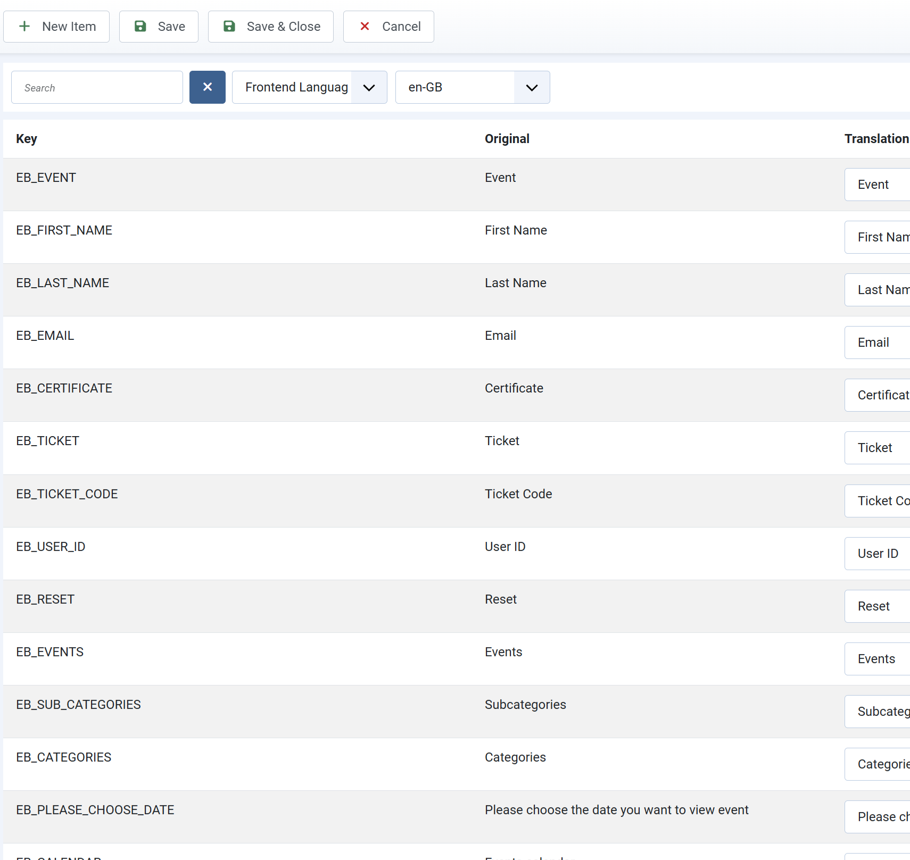

Translation is a very useful feature in **Events Booking**. It allows you to change existing language items, add new language items, translate the extension (both frontend and backend language files) to other languages without having to access to language file directly

To access to Translation management page, there are 3 different ways:

1. Access to **Components -> Events Booking -> Translation**
2. Access to Events Booking **Dashboard**, then click on **Translation** icon.
3. On any pages in Events Booking, access to **Translation** menu item.

## Update / Change existing language items
If you need to update an existing languages items, on Translation management screen, search for that language item / language string, make the change, the press Save button in the toolbar to get it saved.

## Add New Language Item
Sometime, you will have to add a new language item to your language file. This usually needed when you install a new payment plugin and need to add extra language items to the extension

To do that, please follow the steps below:
1. Press **New Item** Button in the toolbar
2. Enter the **language key** into **Key** textbox
3. Enter the **language string** corresponding to that **language key** into **Translation** textbox
4. Press **Save** button in the toolbar

## Translate Language Files To New Language

If you use a none English language in Events Booking and there is not a language package for that language available yet, you will need to translate language files of Membership Pro from English to your language. To do that, on Translation Mangement Screen:

1. Select the language you want to translate to in **Select Language** dropdown
2. In the language file, select **Frontend Language** if you want to translate frontend language file, select **Backend Language** if you want to translate backend language file and select **Common Language** if you want to translate common language file (the language file shared by both frontend and backend language item)
3. Do the translation
4. Press **Save** button in the toolbar

## Using Events Booking in none English language

When you install Events Booking, sample data (including emails messages, custom fields) is generated using **English** language. In case you use Events Booking in none English language, beside translate language items to your language, you will also have to translate some other items in the extension to your language

1. **Translate Custom Fields**: Go to **Events Booking -> Custom Fields**, edit the custom field, change the title (and description if available) to your language
2. **Translate Emails & Messages**: Go to **Events Booking -> Emails & Messages**, translate all existing messages to your language