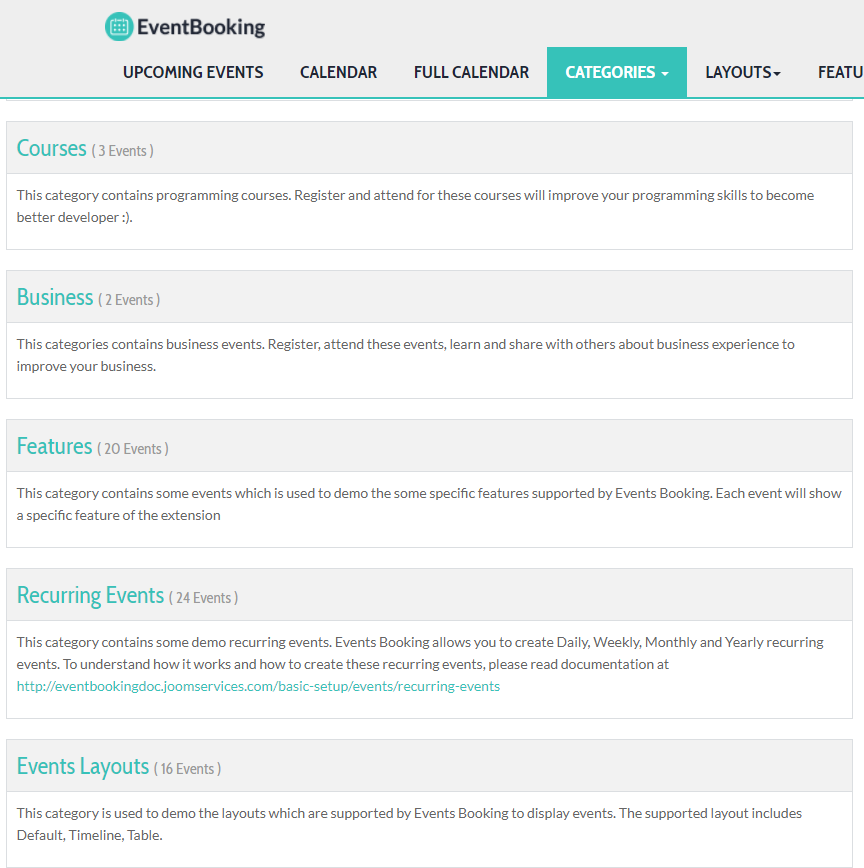
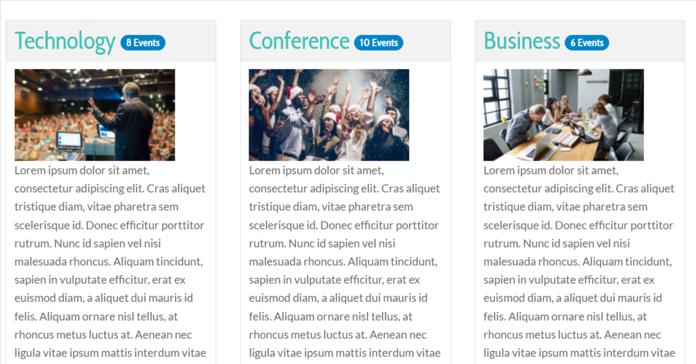
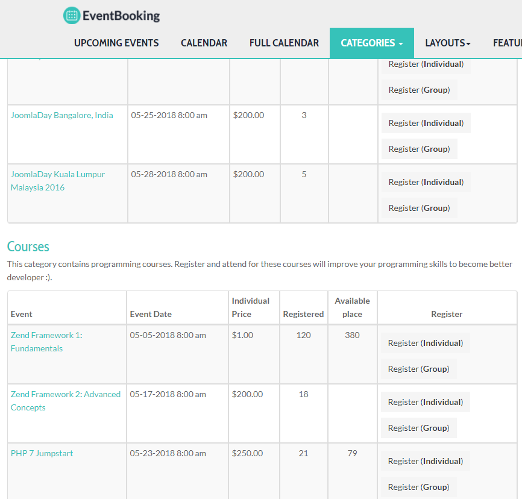

Categories page displays list of categories which you setup in Events Booking on your site. From that page, users can click on a category to see list of events from that category (and it's children categories if available). There are three menu options can be used to display categories in Events Booking:

## Categories - Default Layout

To use this layout, you need to create a menu item to link to **Categories - Default Layout** menu item type of **Events Booking**. Beside common Joomla menu items parameters, this menu option supports the following parameters specific to Events Booking:

### Details tab
- **Category**: If you choose a category in this parameter, the system will display all children categories of that selected category, otherwise, top level categories will be displayed.

### Options tab:
- **Categories**: If you select some categories in this parameter, only these selected categories will be displayed.
- **Exclude Categories**: If you want to exclude certain categories from being displayed, select these categories here.
- **Hide Children Categories**: If set to Yes, when users click on a category from this page, children categories of that clicked category won't be displayed (so only events belong to the clicked categories will be displayed)
- **Intro Text**: If you want to have some text displayed at the beginning of this page, enter that text into this parameter.

## Categories - Columns Layout

This layout displays categories in columns format. To use this layout, you need to create a menu item to link to **Categories - Columns Layout** menu item type of **Events Booking**. Beside common Joomla menu items parameters, this menu option supports the following parameters specific to Events Booking:

### Details tab
- **Category**: If you choose a category in this parameter, the system will display all children categories of that selected category, otherwise, top level categories will be displayed

### Options tab:
- **Categories**: If you select some categories in this parameter, only these selected categories will be displayed.
- **Exclude Categories**: If you want to exclude certain categories from being displayed, select these categories here.
- **Number Columns**: How many categories will be displayed per row.
- **Hide Children Categories**: If set to Yes, when users click on a category from this page, children categories of that clicked category won't be displayed (so only events belong to the clicked categories will be displayed)
- **Intro Text**: If you want to have some text displayed at the beginning of this page, enter that text into this parameter.

## Categories - Events List
This menu option will display list of categories and under each category are events from that category in Table Layout.

To use this layout, you need to create a menu item to link to **Categories - Events List** menu item type of **Events Booking**. Beside common Joomla menu items parameters, this menu option supports the following parameters specific to Events Booking:

### Details tab

- **Category**: If you choose a category in this parameter, the system will display all children categories of that selected category, otherwise, top level categories will be displayed

### Options tab
- **Categories**: If you select some categories in this parameter, only these selected categories will be displayed.
- **Exclude Categories**: If you want to exclude certain categories from being displayed, select these categories here.
- **Number Events Per Category**: Set the number of events displayed under each category on this page (Default 20).
- **Hide Children Categories**: If set to Yes, when users click on a category from this page, children categories of that clicked category won't be displayed (so only events belong to the clicked categories will be displayed)
- **Intro Text**: If you want to have some text displayed at the beginning of this page, enter that text into this parameter.