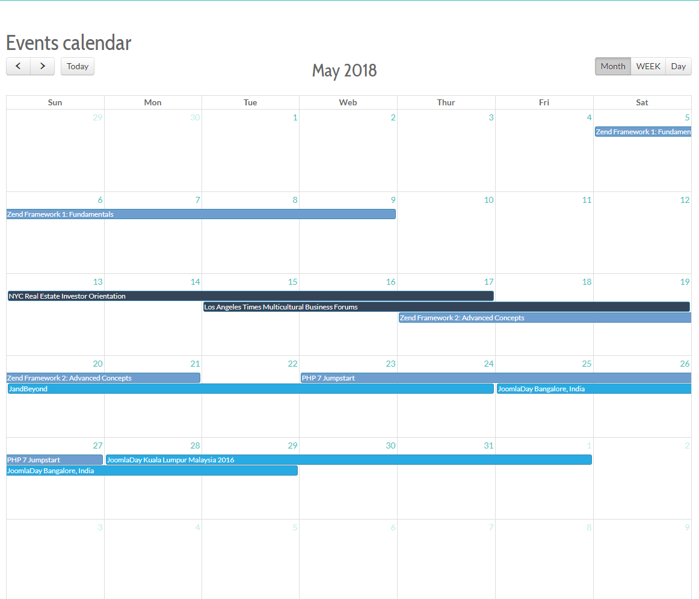

Full Calendar displays display your events on a nice, modern calendar script (https://fullcalendar.io). Users can browse for your events per month, per week or per day from this calendar

To use this layout, you need to create a menu item to link to **Full Calendar** menu item type of **Events Booking**. Beside common Joomla menu items parameters, this menu option supports the following parameters specific to Events Booking:

### Details tab
- **Category**: If you select a category here, only events from that selected category will be displayed. 

### Options tab

- **Categories**: You can select some categories in this parameter and only events from these selected categories will be displayed.
- **Exclude Categories**: You can select some categories in this parameter and events from these selected categories won't be displayed.
- **Location**: You can choose a location in this parameter and only events from that location will be displayed.
- **Default Month**: Choose the month which you want to display events from when the Calendar is first loaded. Set it to **Current Month** to display events from current month.
- **Default Year**: Enter the year which you want to display events from when the calendar is first loaded. Leave it empty to display events from current year.
- **Hide Past Events**: If set to **Yes**, past events (event date smaller than current date) won't be displayed in the calendar. If set to **No**, both past and future events will be displayed. Set it to **Use Global Configuration** to use the value of **Hide Past Events** which you set in Events Booking configuration.
- **Hide Children Events**: If you don't want to display children events (created by additional dates plugins or recurring events), set this parameter to **Yes**. By default, it is **No** and both parent and children events will be displayed.
- **Link Event To Registration Form**: If set to Yes, users will be redirected to Registration Form of the event to process registration when they click on event title in calendar. If set to No, users will see event details page when click on event title.
- **Hide Full Events**: If set to Yes, full events won't be displayed.
- **Override Menu Item ID**: By default, the current menu item will be used as default active menu to generate links to event detail page from the calendar. If for some reasons, you want to use different menu item (for example, when this menu item is a Homepage and you want to navigate to different page when users click on event on this calendar, enter the active menu item you want into this parameter). Usually, this should be empty.
- **Intro Text**: If you want to have some text displayed at the beginning of this page, enter that text into this parameter.

### Calendar Display Options
- **Show Today Button**: Set to Yes to display Today button.
- **Show Month button**: Set to Yes to display Month button allows users to clicking on to browse events using monthly layout
- **Show Week button**: Set to Yes to display Week button allows users to clicking on to browse events using weekly layout
- **Show Day button**: Set to Yes to display Day button allows users to click on to browse events using daily layout
- **Default View** : Choose default View (Month/Week/Day) which will be displayed when the Calendar first loaded
- **Show Weekends**: Set to Yes to include **Saturday/Sunday columns** in any of the calendar views.
- **Hidden Days**: Choose the days in week which will be hidden in the calendar.
- **Show None Current Dates**: Choose whether to include events from previous/next month in the current month view.
- **Slot Min Time**: Determines the first time slot that will be displayed for each day.
- **Slot Max Time**: Determines the last time slot that will be displayed for each day.
- **Time Format Month**: Set format for Time of event displayed on the calendar. By default, event time is displayed in 12 hours format (h:mm a). If you want to use 24 hours format, change this parameter to **HH:mm** . See [https://momentjs.com/docs/#/displaying/](https://momentjs.com/docs/#/displaying/) for list of supported parameters.
- **Other parameters** are used to control the Date/Time formats displayed in calendar. Same with Time Format Month, you can look at [https://momentjs.com/docs/#/displaying/](https://momentjs.com/docs/#/displaying/) to see list of parameters which you can use to control the format.