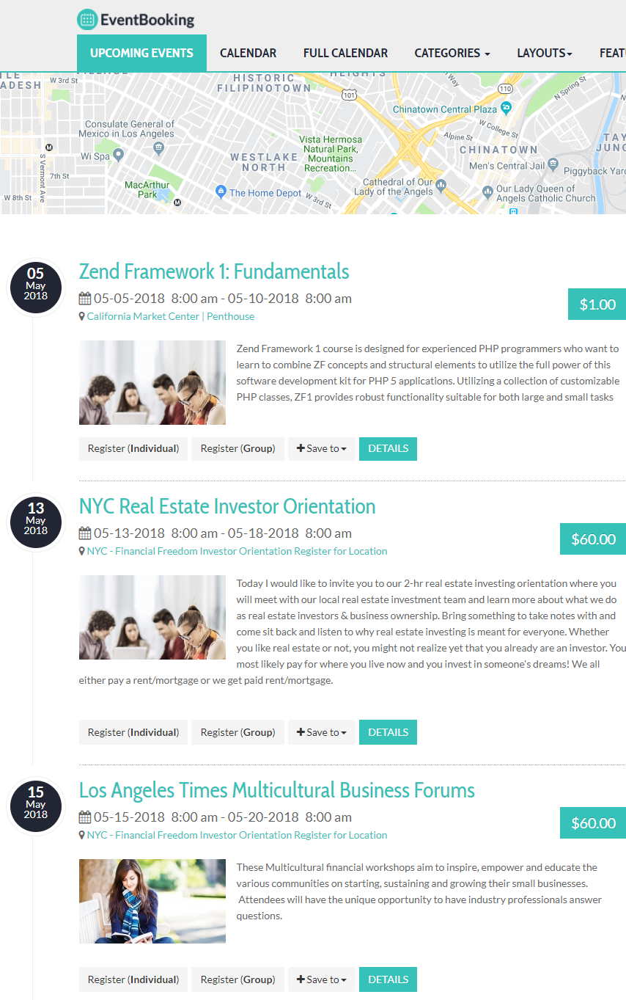
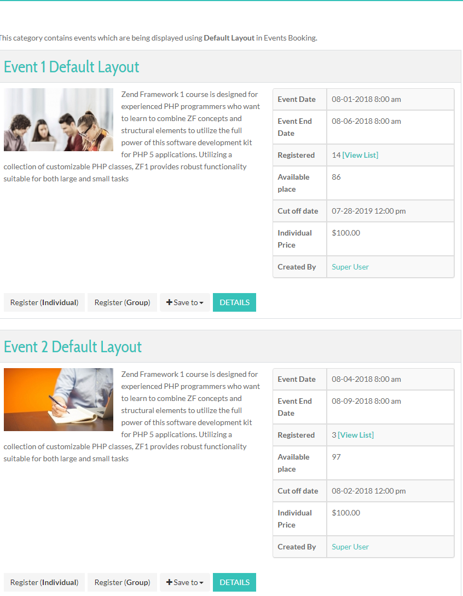
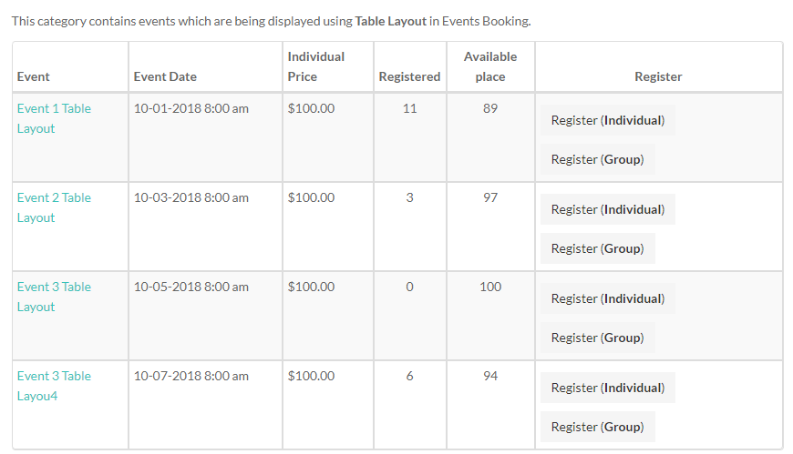
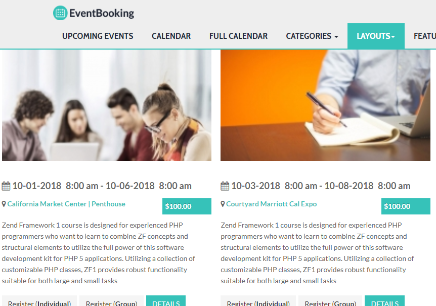
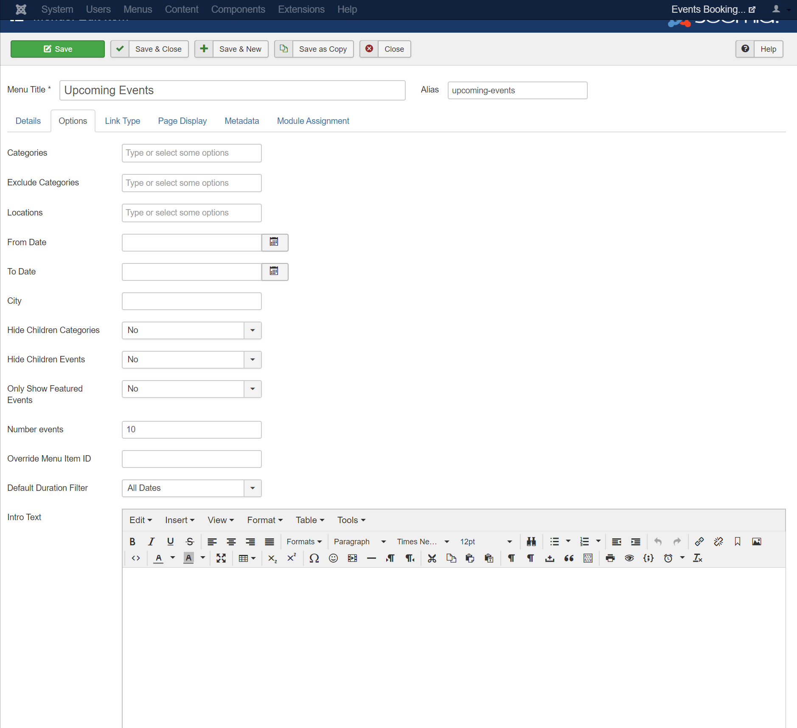

**Upcoming Events** page displays list of upcoming events which you setup in Events Booking on your site. From that page, users can see list of events, click on an event to see details information of that event or click on register buttons to register for the event they want. There are 4 menu options you can use to display upcoming events

## Upcoming Events - Timeline Layout

To use this layout, you need to create a menu item to link to **Upcoming Events - Timeline Layout** menu item type of **Events Booking**. Personal, I think this is the nicest layout to display upcoming events. 

## Upcoming Events - Default Layout

To use this layout, you need to create a menu item to link to **Upcoming events - Default Layout** menu item type of **Events Booking**. 

## Upcoming Events - Table Layout

To use this layout, you need to create a menu item to link to **Upcoming events - Table Layout** menu item type of **Events Booking**. 

## Upcoming events - Columns Layout

To use this layout, you need to create a menu item to link to **Upcoming Events - Columns Layout** menu item type of **Events Booking**. 

## Menu parameters
All the menu options to display upcoming events have same set of parameters. Beside common Joomla menu items parameters, these menu options support the following parameters specific to Events Booking:

### Details tab
- **Category**: If you choose a category in this parameter, the system will display all children categories of that selected category, otherwise, top level categories will be displayed

### Options tab

- **Categories**: You can select some categories in this parameter and only events from these selected categories will be displayed.
- **Exclude Categories**: You can select some categories in this parameter and events from these selected categories won't be displayed.
- **Locations**: You can select some locations in this parameter and only events from these selected locations will be displayed.
- **Speakers**: You can select some speakers in this parameter and only events from these selected speakers will be displayed.
- **Default Duration Filter**: Choose the default duration filter (All Dates, Today, Tomorrow...) for events displayed from this menu item.
- **From Date**: If you you select a date here, only events with **Event Date** greater than or equal this selected date will be displayed.
- **To Date**: If you select a date here, only events with **Event Date** smaller than or equal this selected date will be displayed.
- **City**: If you enter a City here, only events from that City will be displayed.
- **Hide Children Categories**: Control whether sub-categories of the current displayed category (category selected in **Select Category** parameter in **Details** tab) are displayed. Set to Yes to have these sub-categories displayed and set to No to have these sub-categories hidden.
- **Hide Children Events**: If you don't want to display children events (created by additional dates plugin plugins or recurring events), set this parameter to Yes. By default, it is No and both parent and children events will be displayed.
- **Only Show Featured Events**: Set to Yes if you only want featured events to be displayed on this page. Set to No and both featured and none-featured events will be displayed.
- **Duration Filter**: Choose the duration and only events within this seleceted duration will be displayed. Supported duration including: **Today**, **Tomorrow**, **This Week**, **Next Week**, **This Month**, **Next Month**.
- **Number Events**: The number of events displayed per page. If there are more upcoming events than that number, pagination will be displayed to allow navigating to different pages to view other events.
- **Override Menu Item ID**: By default, the current menu item will be used as default active menu to generate links to event detail page from the calendar. If for some reasons, you want to use different menu item (for example, when this menu item is a Homepage and you want to navigate to different page when users click on event on this calendar, enter the active menu item you want into this parameter). Usually, this should be empty.
- **Intro Text**: If you want to have some text displayed at the beginning of this page, enter that text into this parameter. Please note that this text will only be displayed if you do not select any category in **Select Category** parameter in Details tab. If you select a category there, **Description** of the selected category will be displayed instead of this **Intro Text**.

