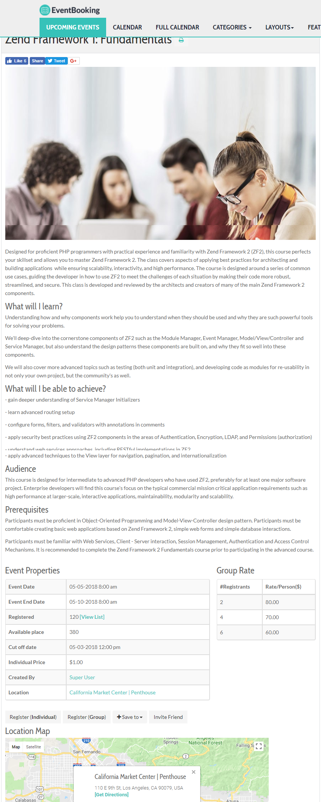

**Event Detail** page displayes detail information of a single event. Users can access to event details page from upcoming events page, from category page, from upcoming events module or from a menu item. From this page, users can see event information (event date, end date, pricing....), click on register buttons to register for this event.

To use this layout, you can create a menu item to link to **Event Detail** menu option of **Events Booking**. Beside common Joomla menu items parameters, these menu options support the following parameters specific to Events Booking:

- **Event**: Choose the event you want to display when users click on this menu item.
