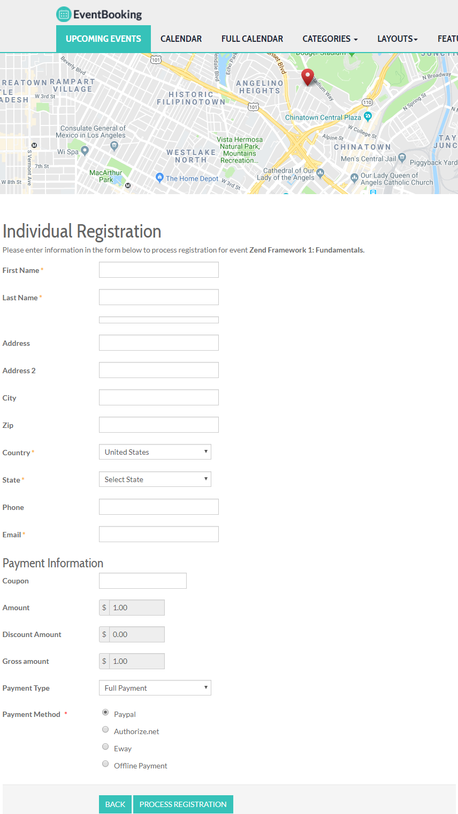
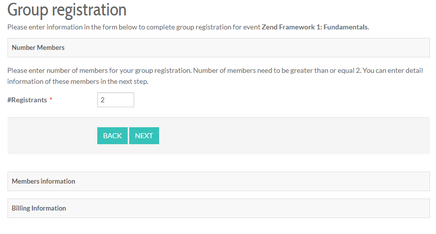
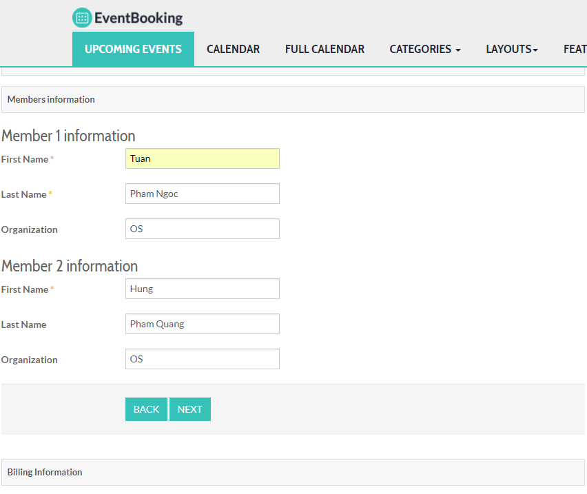
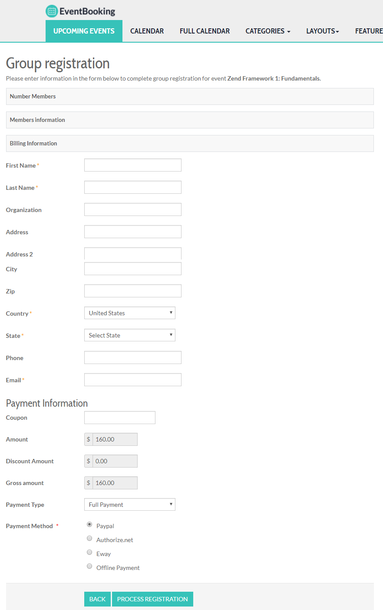

**Registration Form** page displayes registration form to allow users to enter the requested information, process payment to register for a specific event. There are two types of registration form:

## Individual Registration Form
This registration form allow register for a single registrant. Users can reach this Indivual Registration Form by clicking on Register (Individual) button from events list, event details page or from menu item.

If you want users to access to this page from menu item, create a menu item to link to **Individual Registration Form** menu option of **Events Booking**. Beside common Joomla menu items parameters, these menu options support the following parameters specific to Events Booking:

- **Event**: Choose the event you want users to register for when they click on this menu item.

## Group Registration Form
The **group registration form** allow users to register for a group of users (one or more members) in a single registration. Users can reach this Group Registration Form by clicking on Register (Group) button from events list, event details page or from menu item.

If you want users to access to this page from menu item, create a menu item to link to **Group Registration Form** menu option of **Events Booking**. Beside common Joomla menu items parameters, these menu options support the following parameters specific to Events Booking:

- **Event**: Choose the event you want users to register for when they click on this menu item.

Typical, group registration contains three steps:

1. Number Members
On this step, users can enter number of members in the group which they want to register for this event

2. Members Information
On this step, users can enter information of each member

3. Billing information
On this step, users will enter billing information, choose the payment method he wants to use and complete registration

## Customize Registration Form
The registration form in Events Booking is fully customizable.

1. **User registration integration**: If you want to allow your registrants to enter username and password to register for an account on your website when they register for your event, you can go to **Events Booking -> Configuration**, find the config option **User registration integration**, set it to **Yes**.
2. **Show/Hide, Require/Not require form fields**: If you want to make a field on registration form to be showed/hided or required/not required, please go to Events Booking -> Custom Fields, publish/unpublish or mark it as required/not required.
3. **Change title of the custom fields**: Sometime, you might want to change title of the custom field (for example, change it from Organization to Company). In this case, just go to **Events Booking -> Custom Fields**, click on the custom field you want to change and edit it, change the title to meet your need.
4. **Add more custom fields to registration form**: When you first install **Evens Booking**, the extension auto generate a list of pre-defined custom fields which we call Core Fields. They are **First Name, Last Name**......If you want to collect more information of registrants, you can go to **Events Booking -> Custom Fields** and create any extra custom fields you want. With custom fee field feature, you can even config it so that the registration price will be changed based on what options users choose on registration form.