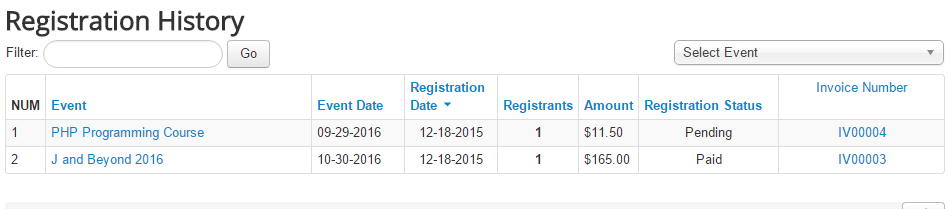
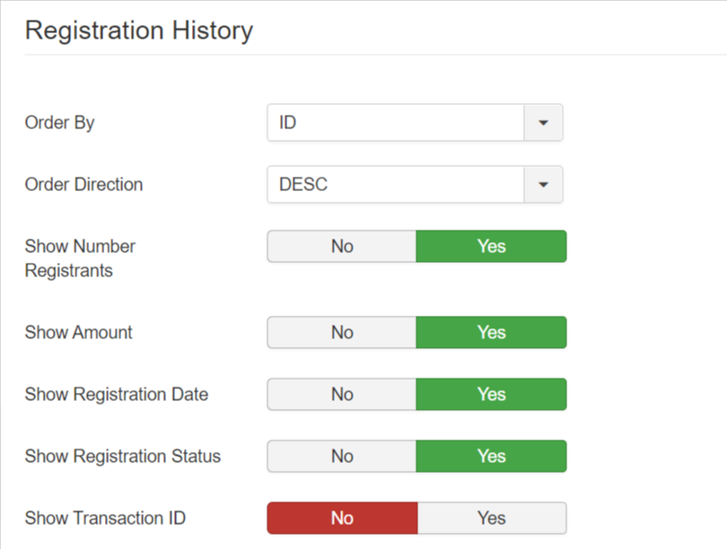

If your registrants have account on your site, you should create a menu item and select **Registration History** menu option of Events Booking so that your registrants can login, access to that menu item, see list of events which they registered, download invoices....

## Customize Registration History
Go to **Events Booking** -> **Configuration**, look at **Themes** tab, **Registration History** section, you can change some settings to:

- Change default ordering of registration records displayed there
- Choose to show/hide some other columns (Number Registrants, Amount, Registration Date, Registration Status, Transaction ID).

If you still want to customize it more, you will need to customize code in the file **components/com_eventbooking/themes/default/history/default.php** . Remember that once the change is done, you should move the modified file to **PATH_TO_TEMPLATE/html/com_eventbooking/history** folder so that the change won't be lost when you update to future releases of the extension.

