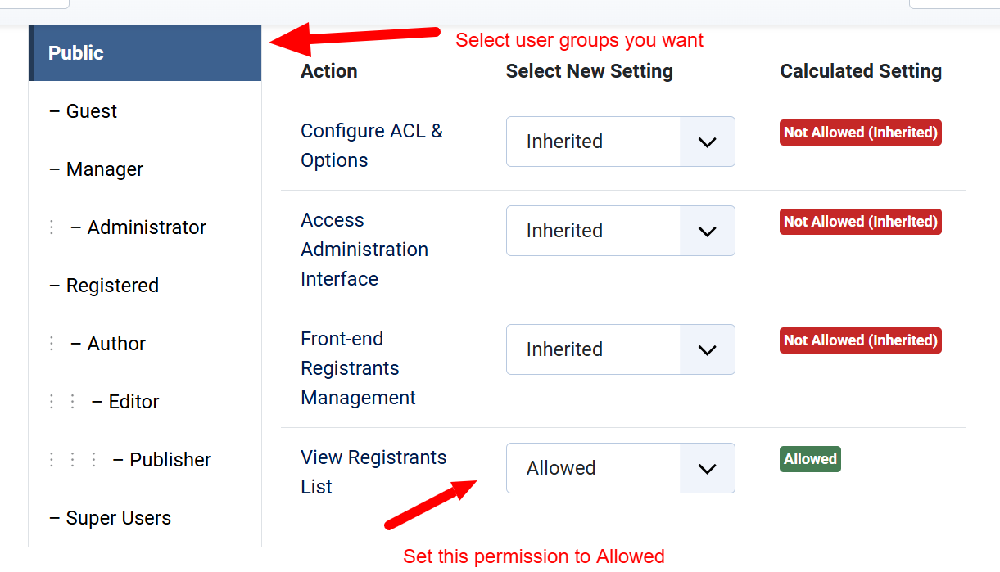
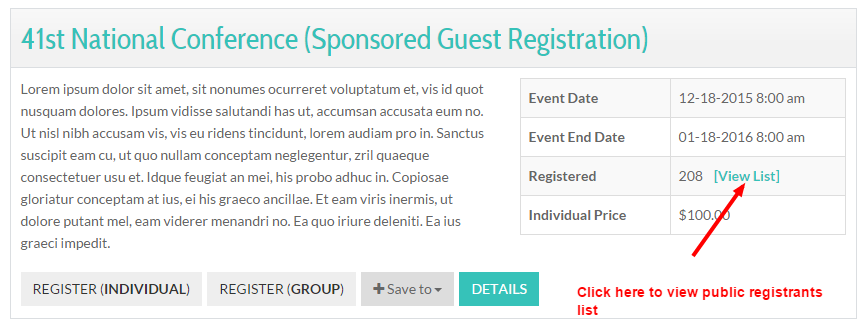

**Events Booking** allows you to config it to display list registrants of an event in the front-end. To display registrants list to front-end users, you need to make few setup steps:

## Enable viewing registrants list

1. Go to **Events Booking -> Configuration**, look at **Themes** tab, find the config option **Show List Of Registrants**, set it to **Yes**.
2. **Permission configuration**: Go to **Events Booking -> Configuration** (or any pages in Events Booking in administrator area), click on **Options** button in the toolbar, select the user group(s) you want to allow viewing registrants list (for example, Public group), set **View Registrant List** permission to **Allowed**. Please note that permission settings in Joomla are inherited, so when you enable this permission for a user group (**Public** in this example), all it's children groups (Registered, Editor, Publisher.... in this example) will have this permission allowed, too.

## Control what information is displayed on registrants list
By default, Events Booking only display the following information on registrants list page: **First Name, Last Name, Number Registrants, Registration Date**. If you want to display additional fields, you will need to go to Events Booking -> Custom Fields, click on the custom fields you want to display to edit, set **Show On Public Registrants List** parameter to Yes.

If you use group registration on your site, go to **Events Booking -> Configuration**, look at **Theme** tab, **Public Registrants List** section and change the following settings to meet your own need if needed:

- **Include Group Billing Records In Public Registrants List**: Set to Yes will display group billing records on the list.
- **Include Group Members Records In Public Registrants List**: Set to Yes will display group members records on the list.

From **Public Registrants List**, you can also choose to Show/Hide the following columns: **Registration Date**, **Ticket Type**, **Registration Status**.

## Sort Registrants List
By default, Events Booking order registrants list by **ID** in **Descending Order**. Basically, latest registrants will be displayed first. If you want to change ordering, go to Events Booking -> Configuration, look at Themes tab, find **Public Registrants List** section, and change the two settings below to meet your need:
- **Order By**: Here you can choose to order registrants list by ID or by any core custom fields like first_name, last_name, email.... If you want order by a custom field which you created (not a core field), you will need to use this tool [http://eventbookingdoc.joomservices.com/tools#make-field-sort-and-searchable](http://eventbookingdoc.joomservices.com/tools#make-field-sort-and-searchable) to make that field search and sortable first. After that, the field will be displayed to allow you to choose.
- **Order Direction**: ASC or DESC.

## How users can view registrants list of an event

1. **From events list and event details page**
When users view your events, there will be a link called **[View List]** display next to number of registered users to allow them click on to view list registrants of that event.

2. **From menu item**

You can also create a menu item to link to **Registrants list** menu option of Events Booking to display registrants of a selected event. In the menu item you created, remember to select the event you want in **Select Event** menu parameter. Users can then access to that menu item to see registrants list of the event which you selected.

3. **At the bottom of event details page**

You can go to Extensions -> Plugins, find and enable the plugin **Events Booking - Registrant list**. When you do that, registrants list of the event will be displayed at the bottom of event details page.