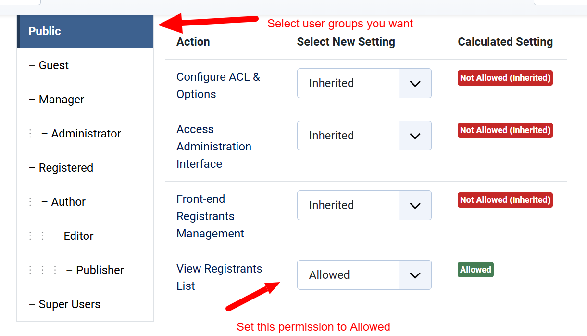

**Events Booking** allows you to config it to display waiting list of an event in the front-end (in case you enable your users to join waiting list of the event when it is full). To display waiting list to front-end users, you need to make few setup steps:

## Enable viewing registrants list

1. Go to **Events Booking -> Configuration**, look at **Themes** tab, find the config options **Show Number Waiting List
**  and  **Show List Of Waiting List** , set it to **Yes**.
2. **Permission configuration**: Go to **Events Booking -> Configuration** (or any pages in Events Booking in administrator area), click on **Options** button in the toolbar, select the user group(s) you want to allow viewing registrants list (for example, Public group), set **View Registrant List** permission to **Allowed**. Please note that permission settings in Joomla are inherited, so when you enable this permission for a user group (**Public** in this example), all it's children groups (Registered, Editor, Publisher.... in this example) will have this permission allowed, too.

## Control what information is displayed on registrants list
By default, Events Booking only display the following information on registrants list page: **First Name, Last Name, Number Registrants, Registration Date**. If you want to display additional fields, you will need to go to Events Booking -> Custom Fields, click on the custom fields you want to display to edit, set **Show On Public Registrants List** parameter to Yes.

Another option to show waiting list of your event is using **Events Booking - Waiting List** plugin as described here [https://docs.joomdonation.com/eventsbooking/plugins/waiting-list](https://docs.joomdonation.com/eventsbooking/plugins/waiting-list)
