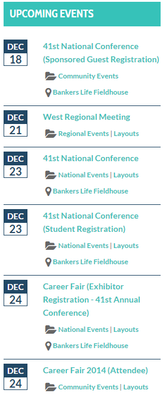
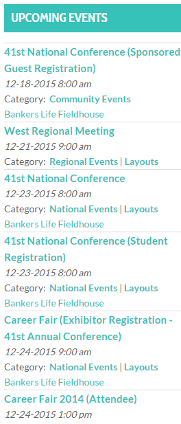
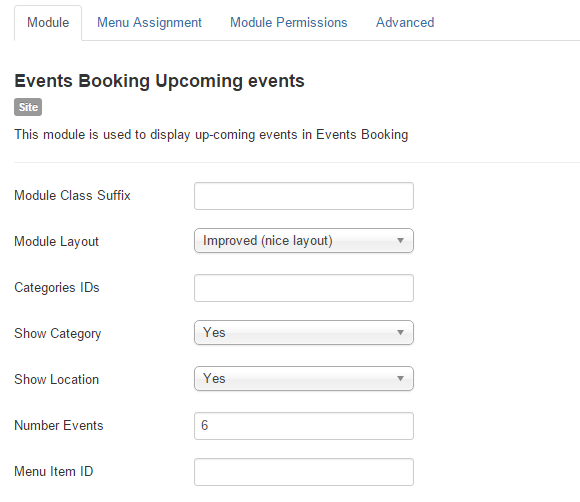

This is the most common used module in Events Booking. It display up-coming events on a module position on your site. To use this module, please create an instance of **Events Booking - Upcoming Events** module and publish it on a module position on your site template. 

  
The up-coming events module has following parameters:
1. **Module Layout**: Choose the layout which you want to use to display events in the module. It has three options: **default**, **improved**, **horizontal**
2. **Categories IDs**: If you leave this parameter empty, events from all categories will be displayed. If you want to display events from certain categories, just enter the IDs of the categories you want into this parameter, comma separated. For example, if you enter **2,5**, events from categories with ID = 1 or ID = 5 will be displayed.
3. **Show Category**: If you want to show categories of the event, set this parameter to Yes
4. **Show Location**: Set to Yes if you want to show location of the event.
5. **Number Events**: Enter number of events you want to display in the module, default value is 6 and 6 events will be displayed.
6. **Itemid**: Enter ID of the default menu item will be used generate SEF link to the events in this module in case there is no menu item could be detected for the event. Something related to SEF router, leave it empty and the module will use default menu item

