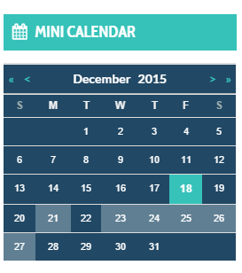

This module simply display dates in a certain month. Users can navigate to the month/year they want. If a certain day in the month have events, users can click on it to see these events and process the registration if they want. To use this module, please create an instance of **Events Booking - Mini Calendar** module and publish it on a module position on your site template

## Module parameters
- **Default Month**: Select the month will be displayed when the module first loaded. After it is loaded, users can navigate to next/previous month.
- **Select Category**: Choose the category you want to display events from. If no category is selected, events from all categories will be displayed.
- **Itemid**: Enter ID of the default menu item will be used generate SEF link to the events in this module in case there is no menu item could be detected for the event. Something related to SEF router, leave it empty and the module will use default menu item