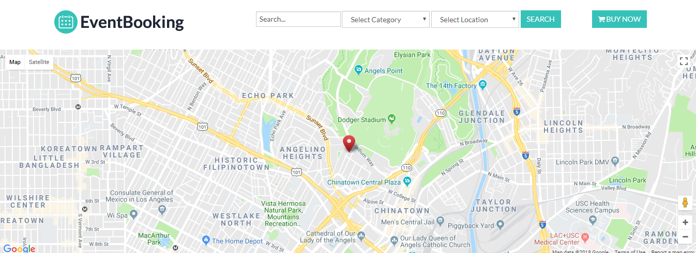

This module displays events on a map (Google Map or Open Street Map depends on Map Provider config option) grouped by locations. To use this module, please create an instance of **Events Booking - Map** module and publish it on a module position on your site template

## Module parameters
- **Center Coordinates**: Center Coordinates of the map. Default to the coordinates of the location of first event.
- **Width**: Map with (in %).
- **Height**: Map height (in px).
- **Zoom level**: Zoom level of the map.
- **Max number events per location**: Max number of events displayed in a location when users click on the map marker of that location on the map.
- **Select category**: Choose the categories to display events from. If no categories are selected, events from all categories will be displayed.
- **Select Locations**: Choose the locations to display events from. If no locations are selected, events from all locations will be displayed.
- **Hide past events**: Choose to show/hide past events on the map
- **Disable scrollwheel**: Set to Yes to disable mouse scroll-wheel scaling with Google Maps API.
- **Itemid**: Enter ID of the default menu item will be used generate SEF link to the events in this module in case there is no menu item could be detected for the event. Something related to SEF router, leave it empty and the module will use default menu item