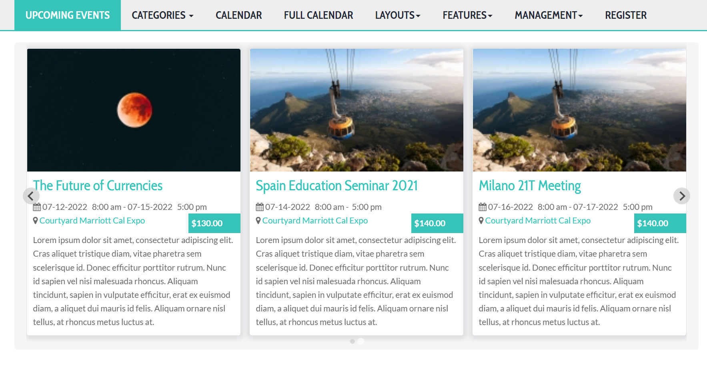

This module allows displaying events using slider. To use this module, please create an instance of **Events Booking - Events Slider** module and publish it on a module position on your site template. 

  
The up-coming events module has following parameters:

### Standard Parameters

1. **Display Event Type**: Choose what event type will be displayed with 3 options: **Upcoming Events**, **Past Events** and **All**.
2. **Show Short Description**: Choose to show or hide short description of events in the module.
3. **Only Show Featured Events**: Set to Yes if you only want to display events marked as Featured in the module
4. **Categories**: Choose the categories which you want to display events in this module. If no categories are selected, events from all categories will be displayed.
5. **Locations**: Choose the locations which you want to display events in this module. If no locations are selected, events from all locations will be displayed.
6. **Exclude Categories**: If you want to exclude events from certain categories from being displayed, select these categories in this parameter.
7. **Speakers**: If you choose certain speakers here, only events have these speakers will be displayed.
8. **Show children events**: Choose whether to show or hide children events in the module
9. **Created By**: If you select a user in this parameter, only events created by this user will be displayed.
10. **Duration Filter**: Select the duration which you want to display events from (Today, Tomorrow....).
11. **Number Events**: Enter number of events you want to display in the module, default value is 6 and 6 events will be displayed.
12. **Order By**: Choose how to order events in this module
13. **Order Direction**: Select order direction (ASC, DESC) of events displayed in this module.
14. **Menu Item ID**: Enter ID of the default menu item will be used generate SEF link to the events in this module in case there is no menu item could be detected for the event. Something related to SEF router, leave it empty and the module will use default menu item.

## Slider Settings
1. **Theme**: Choose the theme you want to use for the slider.
2. **Arrows**: Determines whether to create arrows or not
3. **Pagination**: Determines whether to create pagination or not
4. **Number Items**: Number of slides being displayed in the viewport
5. **Auto Play**: Whether the slider should be auto-played
6. **Speed**: Enter slider speed, the larger number, the higher speed
7. **Gap**: The gap between slides. The CSS format is acceptable, such as 1em

## Reponsive Paramers

Allow you to decide how many events will be displayed per slide depends on the width of the viewport

- **Number Items Extra Small Viewport (less than 576px)**: Number of slides being displayed In Extra Small viewport (portrait phones, less than 576px)
- **Number Items Small Viewport (less than 768px)**: Number of slides being displayed In Small viewport (landscape phones, less than 768px)
- **Number Items Medium Viewport (less than 992px)**: Number of slides being displayed In Medium viewport (tablets, less than 992px)
- **Number Items Large Viewport (less than 1200px)**:Number of slides being displayed In Large viewport (desktops, less than 1200px)

