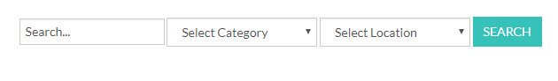

This module allows users to search for events base on categories, locations, keywords....To use this module, please create an instance of **Events Booking - Search Events** module and publish it on a module position on your site template. 

  
The up-coming events module has following parameters:
1. **Category ID**: If you enter a category ID here, the system will only search for event from this category only.
2. **Show Category**: Choose to show/hide category dropdown to allow searching events from selected category
3. **Show Location**: Choose to show/hide location dropdown to allow searching events from selected location
4. **Search Result Layout**: Choose the layout you want to use to display search result (Default, Timeline, Table, Columns)
5. **Module Layout**: Choose the layout to render module (**default**, **horizontal**)
6. **Itemid**: Enter ID of the default menu item will be used generate SEF link to the events in search result in case there is no menu item could be detected for the event. Something related to SEF router, leave it empty and the module will use default menu item.