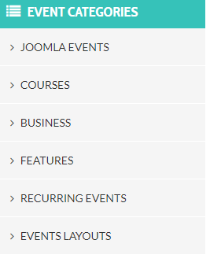

This module displays list of categories to allow users to click on to view events from each category.To use this module, please create an instance of **Events Booking - Event Categories** module and publish it on a module position on your site template. 

  
The up-coming events module has following parameters:
1. **Parent Category Id**: If you enter ID of a category here, the module will only display children categories of that category. Otherwise, top level categories will be displayed.
2. **Number Categories**: Number of Categories to be displayed on the module
3. **Itemid**: Enter ID of the default menu item will be used generate SEF link to the categories in the module in case there is no menu item could be detected for the category. Something related to SEF router, leave it empty and the module will use default menu item.