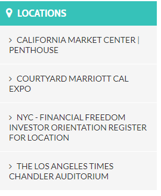

Display list of locations to allow users to click on to view events from each location

This module displays listlist of locations to allow users to click on to view events from each location.To use this module, please create an instance of **Events Booking - Events By Location** module and publish it on a module position on your site template. 

  
The up-coming events module has following parameters:
1. **Number Locations**: Number of locations to be displayed on the module
2. **Show number events**: If set to Yes, we will show number of events next to the location
3. **Itemid**: Enter ID of the default menu item will be used generate SEF link to the locations in the module in case there is no menu item could be detected for the location. Something related to SEF router, leave it empty and the module will use default menu item.