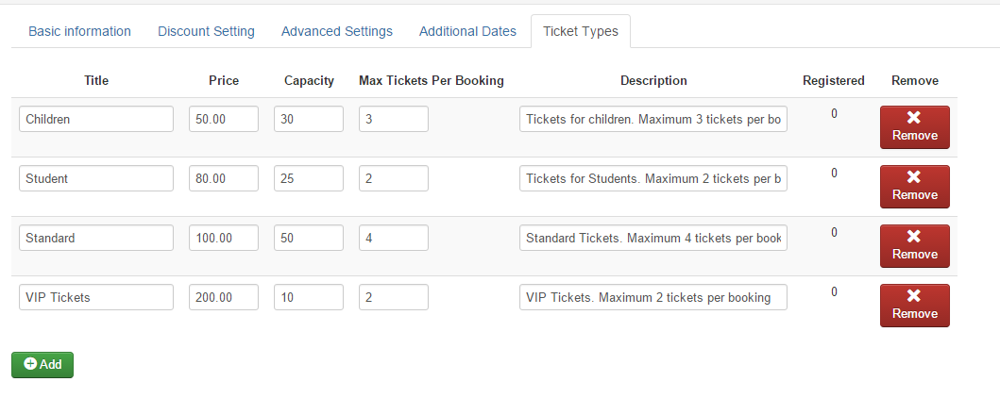
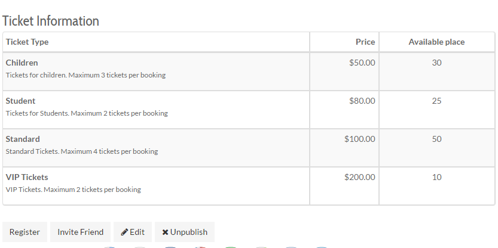
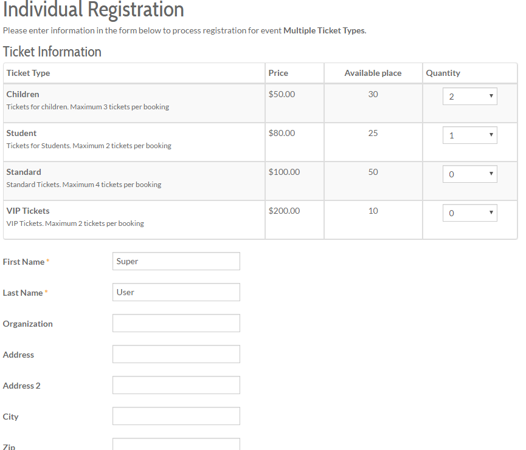

This plugin allows you to define multiple ticket types for an event, see [https://demo.joomdonation.com/eventsbooking/features/advanced-features/multiple-ticket-types](https://demo.joomdonation.com/eventsbooking/features/advanced-features/multiple-ticket-types) for a sample event which has multiple ticket types.

1. Each ticket type can have it own **title, description, price, capacity, quantity limit per booking** as showed in the image below:
2. The ticket types which you setup for the event will be displayed on event list and event details page like in the screenshot below so that users can see what ticket types are avaialble, what's the price and how many tickets of each type left...
3. On registration form, registrants can select number of each ticket types they want to purchase, make payment to complete registration. Of course, the price will be changed depend on the ticket types they purchase and the quantity they select

If you want to use this feature:
1. Go to Extensions -> Plugins Manager, find and publish the plugin **Events Booking - Ticket Types**
2. Now, when you add/edit event, you will see a new tab called **Ticket Types** allowing to setup ticket types for that event
3. If you want **number of registrants** of the registration record (by default, it set to 1) calculated base on the quantity of each ticket types registrants select, go to Events Booking, find the config option **Calculate Number Registrants Based on Tickets Quantity**, set it to **Yes**

## Discount Rules

Sometime, you might want to give registrants discount base on number of tickets they purchase for each ticket type. For that purchase, you can use Discount Rules. It can be defined for each ticket types: For example:

### Fixed Discount Amount

**2:5,4:10,6:25**. With this sample discount rules:
- If someone purchases 6 or more tickets of that ticket types, he will get 25$ discount
- If someone purchases 4 tickets or more (but smaller than 6), they will get 10$ discount
- If someone purchases more than 2 ticket (but smaller than 4), they will get 5$ discount

As you can see, with discount rule for each ticket type, you can:

- Define quantity and the discount amount for each quantity
- The discount amount which users received will be determined by the number of tickets he purchased for the ticket type. The number of tickets which registrant purchases will be compared with the largest quatity which admin define in Discount Rule to get the latest possible discount (the more number of tickets purchased, the more discount he gets)

### Discount By Percent

**2:5%,4:10%,6:25%**. With this sample discount rules:
- If someone purchases 6 or more tickets of that ticket types, he will get 25% discount for that ticket type
- If someone purchases 4 tickets or more (but smaller than 6), they will get 10% discount for that ticket type
- If someone purchases more than 2 ticket (but smaller than 4), they will get 5% discount for that ticket type

This setting (for each ticket type) is disabled by default. If you want to use it, go to Extensions -> Plugins, find the plugin Events Booking - Ticket Types, click on it to edit, set Enable Discount Rules parameter to Yes and you will be able to use this option.