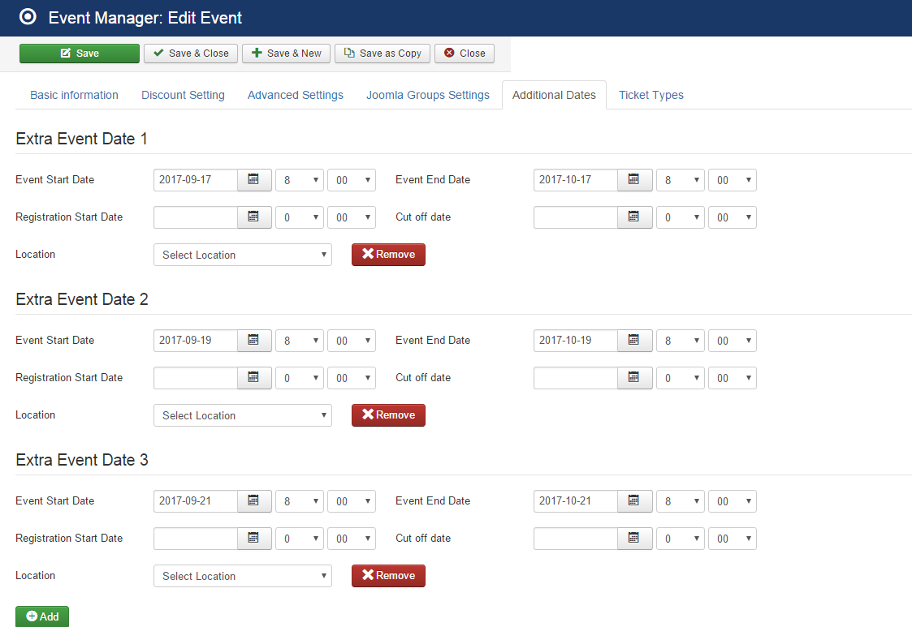

This plugin allows you to add more dates to an existing event. It works in the same way with recurring events, the only difference is that the dates must be entered manually. If you have an event with different dates, that will help saving your time (you won't have to use Save As copy button to create new event, just add additional dates to that event via the plugin). See [http://joomdonationdemo.com/eventbooking/features/advanced-features/multiple-dates](http://joomdonationdemo.com/eventbooking/features/advanced-features/multiple-dates) for a sample events which has multiple dates.

If you want to use this plugin, please follow the instruction below:
1. Go to Extensions -> Plugins Manager, find and publish the plugin **Events Booking - Additional Dates**
2. Now when you add, edit an event, there will be a new tab called **Additional Dates** to allow you to add more dates to the event 
3. If you want these additional dates to be displayed on event details page so that registrants can easy select the date they want to register like on this sample event ([http://joomdonationdemo.com/eventbooking/features/advanced-features/multiple-dates](http://joomdonationdemo.com/eventbooking/features/advanced-features/multiple-dates), go to Events Booking -> Configuration, find the config option **Show children events date under parent events**, set it to **Yes**
