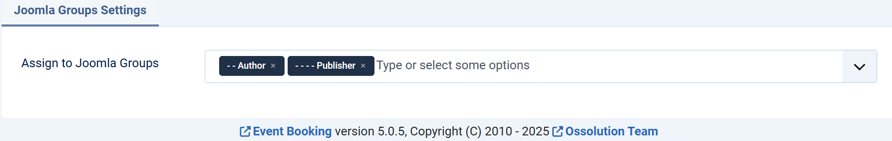

Sometime, you will want that when users register for an event, they will be assigned to the **Joomla user group(s)** you want so that you can use Joomla core ACL to give them permissions to perform some actions or access to restricted resources on your site (of course, these resources are not available for public and normal registered users). Please follow the steps below to setup it if you want to use this feature:
1. Login to back-end of your site as a super admin account.
2. Go to **System -> Plugins**, find and enable the **Events Booking - Joomla Groups** plugin.
3. Now, when you add/edit an event, you will see a new tab called **Joomla Groups Settings**. Select the user group(s) you want on that tab and when users register for the event, they will be assigned to that selected groups. 

If you want to restrict access to resources to your registrants based on Joomla core ACL (you need to understand how Joomla ACL works), this will be a very powerful and flexible plugin.

