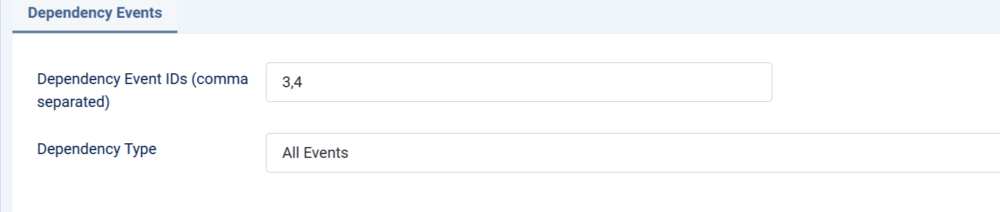

You might have an event which depends on other events. That mean users need to register for the other events first before they are allowed to register for the main event. That could be handled using **Events Booking - Event Dependencies** plugin

1. Login to back-end of your site as a super admin account.
2. Go to **System -> Plugins**, find and enable the **Events Booking - Event Dependencies** plugin.
3. Now, when you add/edit an event, you will see a new tab called **Dependency Events**. It has two parameters:

- **Dependency Event IDs (comma separated)**: Enter IDs of the events which the current event depends on.
- **Dependency Type**: Set to **All Events** if you want users to register for all dependency events before they can register for the current event. Set to **One Of The Events** if you want users to register for one of the dependency event before they can register for current event.

