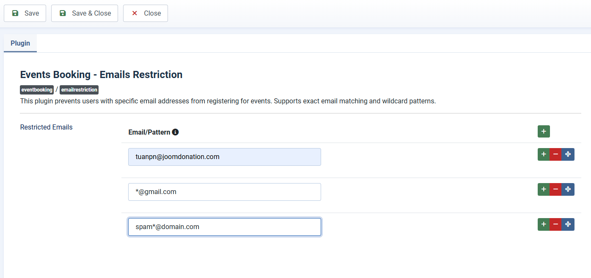

This plugin prevents users with specific email addresses from registering for events. Supports exact email matching and wildcard patterns. If you want to use this feature:

1. Login to back-end of your site as a super admin account.
2. Go to **System -> Plugins**, find and enable the **Events Booking - Emails Restriction** plugin.
3. Click on the plugin to edit and setup the restrictions from there. Keep in my that you can restrict access to specific email addresses or use wildcard, for example, to restrict all emails from certain domains.

