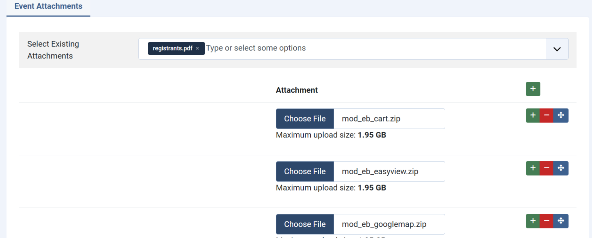

This plugin is a replacement for standard attachments field on add/edit event form to allow you to easily upload multiple attachments for your event. These attachments can then be displayed on event details page to allow users to download or can be sent to confirmation email when registrants register for your event.

1. Go to System -> Plugins Manager, find and publish the plugin **Events Booking - Attachments**
2. Now, when you add/edit event, you will see a new tab called **Event Attachments**. There you can select existing attachments for your event or add and upload many attachments as you want for the event.

