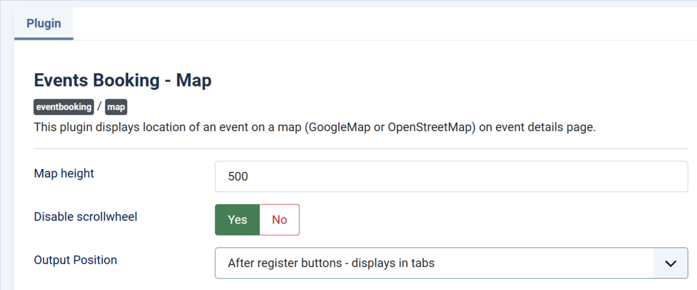

Normally, on event detail page, users will have to click on the **Location Name** of the event to view that location on google map 

If you want to display map directly on event detail page, please go to **System -> Plugins**, find and enable the plugin **Events Booking - Map**.  You might also want to change the following parameters if needed:

- **Map Height**: Control height of the map.
- **Disable Scrollwheel**: Enable/Disable scroll-wheel.
- **Output Position**: Control where the map is being displayed (before or after Register buttons).

