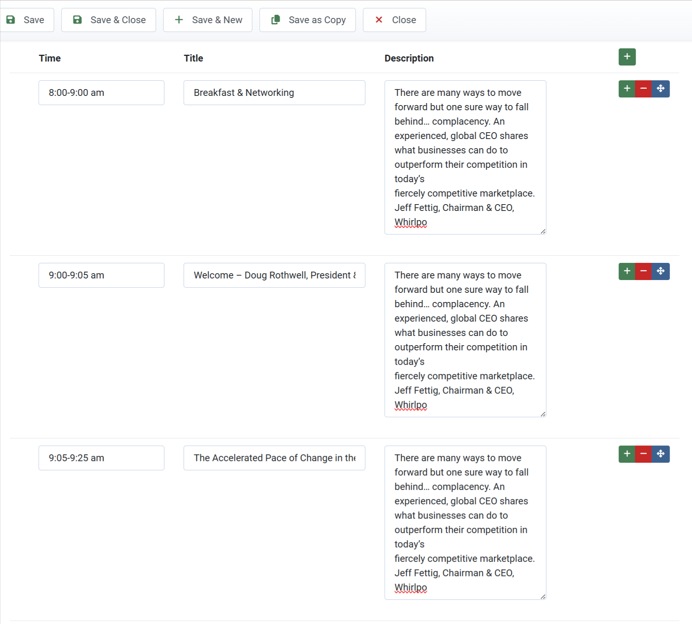

This plugin allows you to add and display agendas for an event, see [https://demo.joomdonation.com/eventsbooking/features/advanced-features/agendas-speakers-sponsors](https://demo.joomdonation.com/eventsbooking/features/advanced-features/agendas-speakers-sponsors) , look at **Agendas**  section for a sample event which has agendas feature.

To use this feature:

1. Go to **System -> Plugins Manager**, find and publish the plugin **Events Booking - Agendas**.
2. Now, when you add/edit event, you will see a new tab **Agendas** allowing to setup agendas for that event and agendas will be displayed on event details page.

