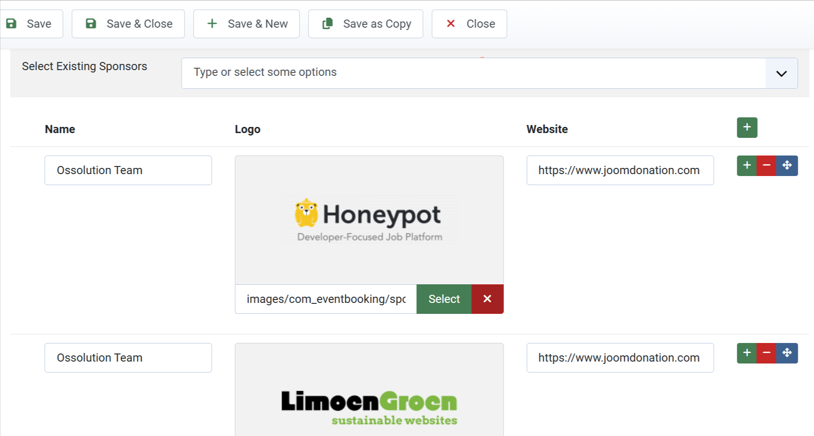

This plugin allows you to add and display sponsors for an event, see [https://demo.joomdonation.com/eventsbooking/features/advanced-features/agendas-speakers-sponsors](https://demo.joomdonation.com/eventsbooking/features/advanced-features/agendas-speakers-sponsors) , look at **Sponsors**  section for a sample event which has sponsors feature.

To use this feature:

1. Go to **System -> Plugins**, find and publish the plugin **Events Booking - Sponsors**.
2. Now, when you add/edit event, you will see a new tab **Sponsors** allowing to add sponsors for that event.
3. Add any number of sponsors you want and it will be displayed in the frontend, on event detail page

