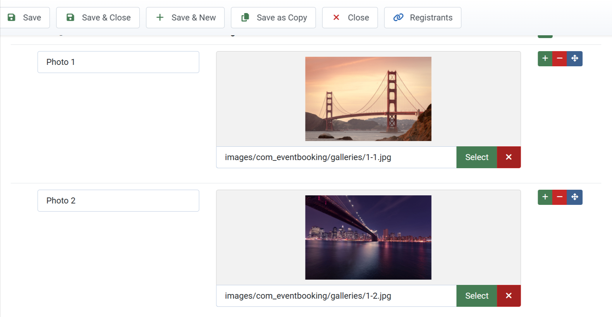
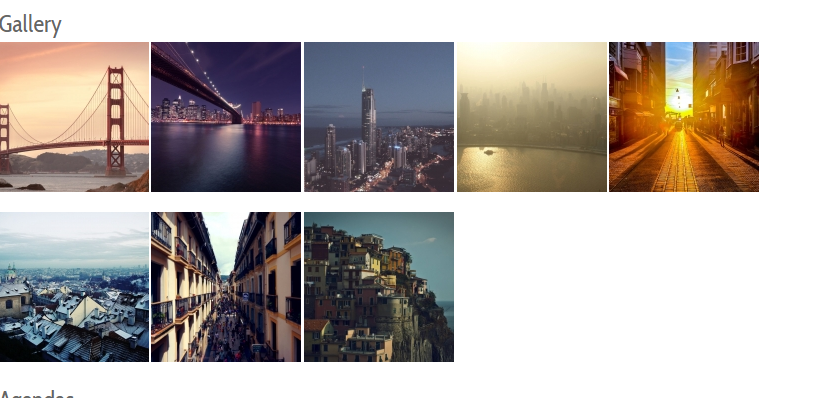

This plugin allows you to add and display images gallery for an event, see [https://demo.joomdonation.com/eventsbooking/features/advanced-features/gallery-plugin](https://demo.joomdonation.com/eventsbooking/features/advanced-features/gallery-plugin), look at **Gallery** section for a sample event which has gallery feature.

1. Go to **System -> Plugins**, find and enable the plugin **Events Booking - Gallery**. The plugin has some parameters which you should look at and change if needed:
- **Thumb Width**: Width of the generated thumbnail
- **Thumb Height**: Height of the generated thumbnail
- **Output Position**: Choose where you want the gallery to be displayed on event details page.
2. Now when you add/edit an event, you will see a new tab **Gallery** to allow you to add images for your event. For each image, you can enter some text to describe about the image if needed

3. When event is displayed in the front-end of your site, there will be a gallery section to display thumbnail images. Click on the thumbnail to see large image and also navigate to view other images

