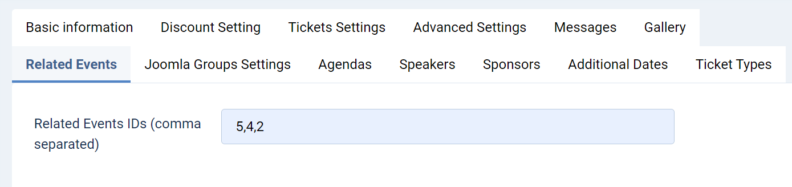
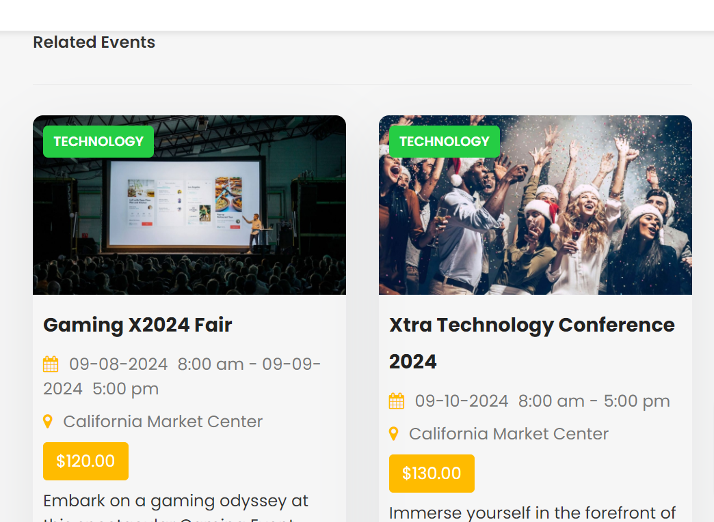

This plugin allows you to link related events to the primary/main event. It allows users to discover and register for associated events easier. If you want to use this feature

1. Go to Extensions -> Plugins Manager, find and enable the plugin **Events Booking - Related Events**
2. Now, when you add/edit event, you will see a new tab called **Related Events**. There you can enter IDs of the related events of the current main event. On frontend of your site, when users view the main event, it's related events will be displayed at the bottom

