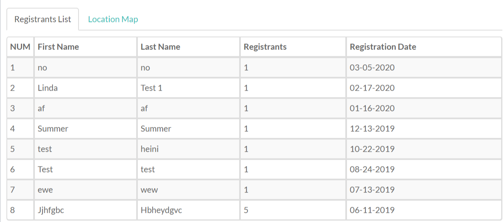

This plugin allow displaying registrants list of an event on event details page so that users who is viewing the event can see who is attending the event.

If you want to use this feature, go to Extensions -> Plugins, find and enable the plugin **Events Booking - Registrant List**. Then on event details page, registrants of that event will be displayed like the attached screenshot.

