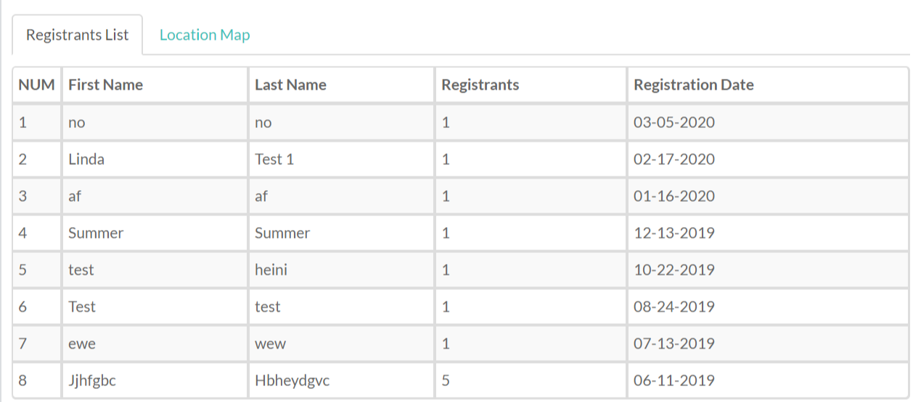

This plugin allow displaying waiting lists registrants of an event on event details page so that users who is viewing the event can see who is in waiting lists of the the event (in case Watiing List is enabled for the event)

If you want to use this feature, go to Extensions -> Plugins, find and enable the plugin **Events Booking - Waiting List**. Then on event details page, registrants of that event will be displayed like the attached screenshot.

