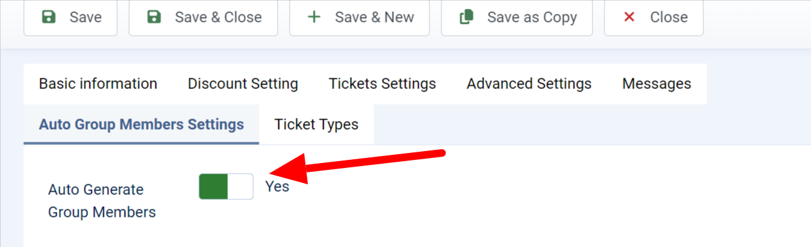

This plugin allows auto generating group members without requiring the person who perform registration to enter data for these members. It is useful when you use Tickets PDF feature, want the system to generate separate PDF tickets for the registration without collecting members information.

1. Go to System -> Plugins, find and enable the plugin **Events Booking - Auto Group Members Generator**
2. Now when you add/edit an event, you will see a new tab **Auto Group Members Settings**. Set **Auto Generate Group Members** parameter to Yes if you want the plugin to auto generate group members for this registration.

Now, when someone performs group registration for that event, even you do not require them to enter members information, members records will be generated automatically by the system, thus separate PDF tickets will be generated and make it easier to distribute these tickets to members of the group

