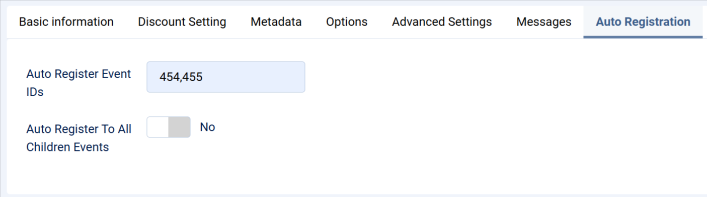
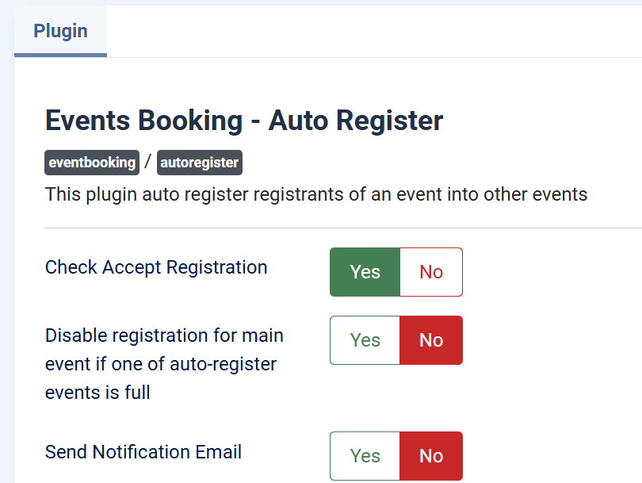

This plugin allow you to configure the system so that when someone register for an event, they will be registered automatically to other events you want (or registered automatically to all children events of that event)

1. Go to **System** -> **Plugins**, find and publish the plugin **Events Booking - Auto Register**
2. Now when you add/edit an event, you will see a new tab **Auto Registration** to allow configuring some parameters below:

* **Auto register Event Ids**: You can enter IDs of the events you want here (comma separated). When someone register for this event, he will be registered automatically to the events which you entered into this parameter.
* **Auto Register To All Children Events
**: Set to **Yes** if you want when someone register for a parent event, he will be registered to all children events of that parent event (children events can be created using recurring events feature or additional dates plugin). 

### Plugin Parameters

The plugin has the following parameters which you might need to adjust to have it works for your own need:

- **Check Accept Registration**: By default, the system only auto-register the registrant to the configured events if that event still accept registration. In some cases, you might want to disable registration for these events (to let users register via the mail event only), in this case, you can set this parameter to **No**.
- **Disable registration for main event if one of auto-register events is full**: If set to Yes and the configured auto-register events are full, the registration for the main event will be disabled.
- **Send Notification Email**: Set to Yes if you want to send notification to registrant for each of the auto-registered registration.

