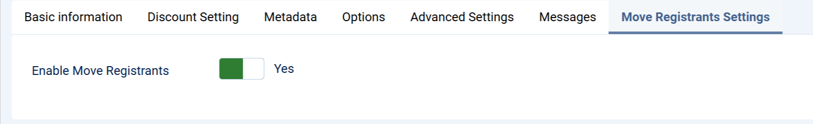
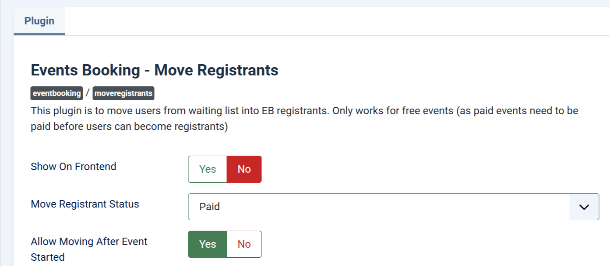

If you activate **Waiting List** feature, when your event is full, users will be able to join waiting list. In that case, they will be stored and showed in Registrants Management with **Waiting List** status.

If you want that when someone cancel his registration for the event, users from waiting lists will be moved to registrants automatically (the first users join the waiting list will have highest priority), you can use this plugin.

Just go to **System** -> **Plugins**, find and enable the plugin **Events Booking - Move Registrants** to use this feature. Now when you add/edit an event, you will see a new tab called **Move Registrants Settings** allow you to enable this feature for the event.

### Plugin Parameters

- **Move Registrant Status**: Control the status of of the registration when it is being moved from waiting list to be registrant. By default, registrant will have **Paid** status but you can change this to **Pending** if needed
- **Allow Moving After Event Started**: By default, the system will move users from waiting list to Registrant whenever there is someone cancel his registration. But if you do not want this happens when the event is already started, you can set this parameter to **No**

