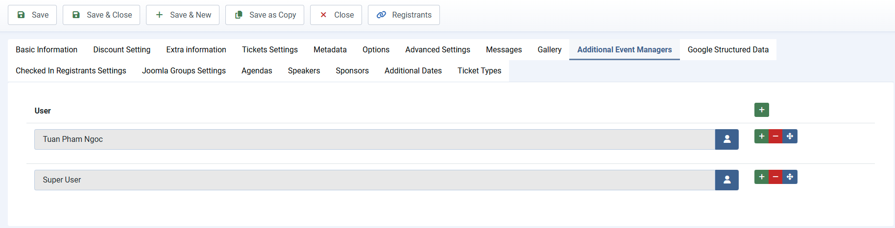

By default, only the event owner can manage registrants for their events from the frontend of your site. If you want to allow additional users to manage registrants for specific events, you can use the **Events Booking – Additional Event Managers** plugin:

- Log in to the backend of your site using a Super User account.
- Go to **System** -> **Plugins**, find and enable the **Events Booking - Joomla Groups** plugin.
- When you add or edit an event, you’ll see a new tab called **Additional Event Managers**. Add the users you want there — they will be allowed to manage registrants for that event.

