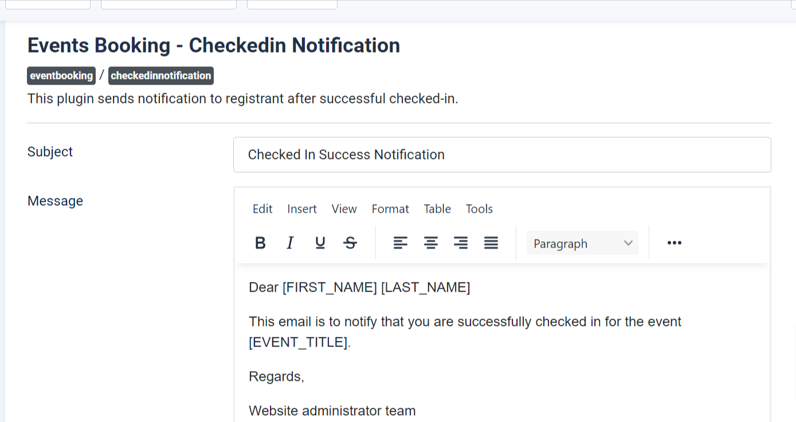

This plugin allows sending email notification after they are successfully being checked in. Beside notification purpose, the email could also be used to send them additional resources after checked in if needed (for example, link to private resources which is only accessible to checked in registrants)

1. Go to **System** -> **Plugins**, find and enable the plugin **Events Booking - Checked-in Notification**. ick on the plugin to edit.
2. Enter data for the following parameters:

- Subject : This is subject of the email sent to registrant
- Message: This is the email message sent to registrant

You can use any tags here [https://docs.joomdonation.com/eventsbooking/email-tags/common-tags](https://docs.joomdonation.com/eventsbooking/email-tags/common-tags) in the subject and message of the email

