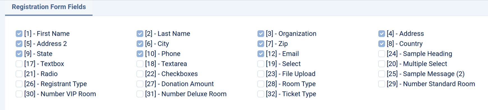

This plugin allows you to assign existing custom fields to your event on Add/Edit event screen. For simple usage, it's easier than you go have to edit the custom field and assign it to event.If you want to use this feature:

1. Go to System -> Plugins, find and publish the plugin **Events Booking - Fields Assignment** plugin.
2. Now, when you add/edit event, you will see a new tab called **Registration Form Fields** allowing to assign your existing custom fields to that event.
3. Please note that on that screen, the custom fields which are assigned to all events will be available for that event by default (Checked and you cannot be de-selected). You can only select the custom fields which are configured to assigned to certain events on custom field add/edit screen. Also, this plugin only works if you have **Custom Fields Assignment** config option set to **Only Events**.

