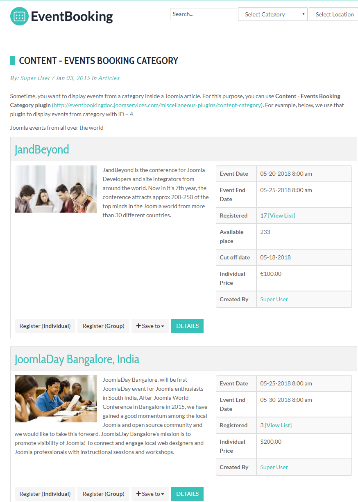

This plugin allows you to display events from a category in the Joomla article you want (or on any page which implement Joomla content plugin like in K2 item). See [https://demo.joomdonation.com/eventsbooking/features/other-features/content-category-plugin](https://demo.joomdonation.com/eventsbooking/features/other-features/content-category-plugin) for an example on our demo site

If you want to use this plugin:
1. Go to **System** -> **Plugins**, find and enable the plugin **Content - Events Booking Category**
2. Edit the article you want to display events from the category, enter this syntax **{ebcategory ID_OF_CATEGORY}**. **ID_OF_CATEGORY** needs to be replaced with ID of category you want to display events from, for example **{ebcategory 1}** will display events from category with ID = 1 in the article

