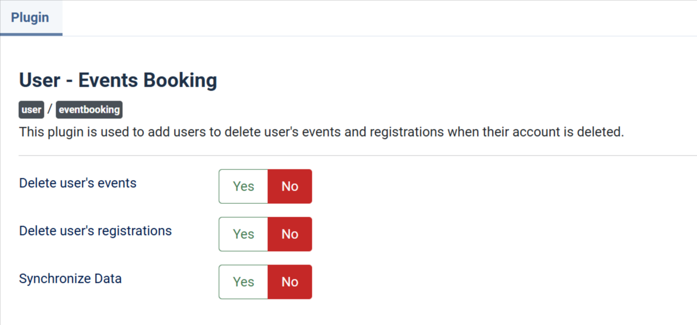

This plugin allows deleting user's events and registration records when their account is deleted. To use it:

1. Go to **System** -> **Plugins**, find and enable **User - Events Booking** plugin.
2. Click on the plugin to edit, there are 3 parameters:
* **Delete user's events**: Set to Yes if you want to delete events submitted by the user when his/her account is deleted (by admin or by herself/himself)
* **Delete user's registrations**: Set to Yes if you want to delete the registration made by the user when his/her account is deleted (by admin or by herself/himself)
* **Synchronize Data**: Set to **Yes** if you want data which users entered during registration process is synchronized back to user profile data.

As this will cause data permanent deleted, please be careful with using this plugin. Normally, I think you only need to use it if your site needs to be be compatible with [GDPR](https://en.wikipedia.org/wiki/General_Data_Protection_Regulation) requirement.

