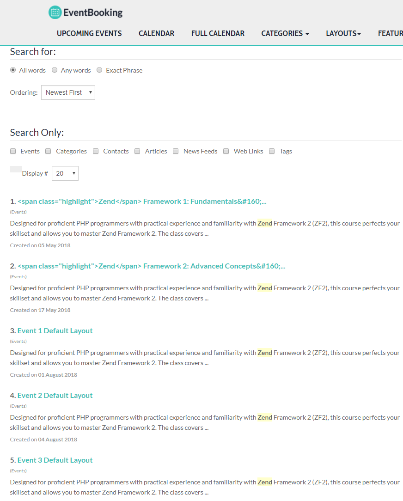

This plugin allows users to search for events via Joomla search module. To use it, all you need to do is go to System -> **Plugins**, find and enable the plugin **Search - Events Booking**

Now, when users try to use Joomla search module or search component to search for content, the matching events will be displayed in search result. Users can also be able to choose search for events only from that search form!

