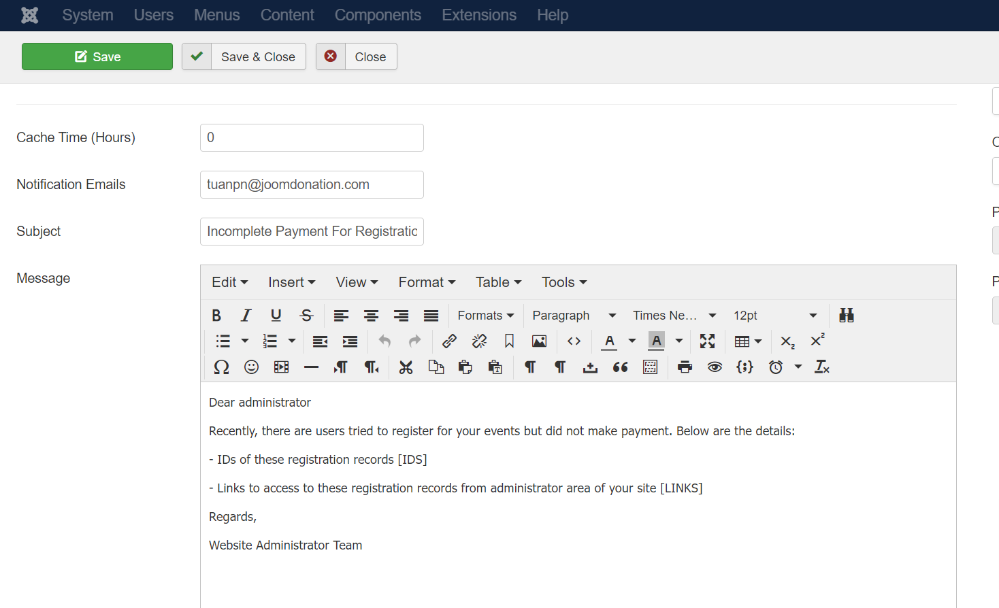

>>> This plugin was removed from version 5.0.7. Please use **[Events Booking - Incomplete Payment Registrations Notification](/scheduled-tasks/incomplete-payment-registrations-notification)** scheduled task instead.

Each time the plugin runs, it will check and send notification to administrators list of registration records which failed to process payment for the registration (payment processing error or users ignore the payment process....). By default, it will be run every 12 hours, you can change **Cache Time (Hours)** parameter to have it run more often if needed (for example, every 4 hours)

## Configure The Plugin
To use this plugin, you need to go to **System -> Plugins**, find and enable **System - Incomplete Payment Registrations Notification** plugin. It has following parameters, you can be changed it to meet your own need:

- **Notification Emails**: Enter emails you want to receive notification, comma separated. For example email1@domain.com,email2@domain.com. If you leave it empty, the **Notification Emails**  in event or in Events Booking -> Configuration will receive notifications.
- **Subject**: Subject of the notification email.
- **Message**: Message of the notification email.

## Supported Tags
- Use [IDS] tag to show IDs of the registration records which did not complete payment (comma separated)
- Use [LINKS] tag to show IDs of these registration records and link to each registration record (from backend registrants management)

