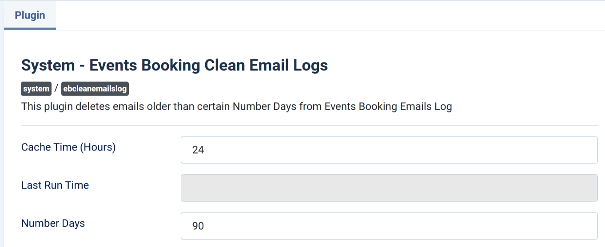

>>> This plugin was removed from version 5.0.7. Please use **[Events Booking - Clean Emails Log](/scheduled-tasks/clean-emails-log)** scheduled task instead.

This plugin if enabled, will delete emails older than certain number of days (by default 90 days) from emails log. That helps reducing number of emails stored in database in case you have many emails sent from system (so save your hosting space)

## Configure The Plugin
To have system send registrants to administrators email, you need to go to **System -> Plugins**, find and enable **System - Events Booking Clean Email Logs** plugin. It has following parameters, you can review and change it to meet your own need if needed

- **Number Days**: Enter Number Of Days you want to keep your emails in emails log.  If emails older than this configured Number Days, it will be deleted automatically by the plugin.

