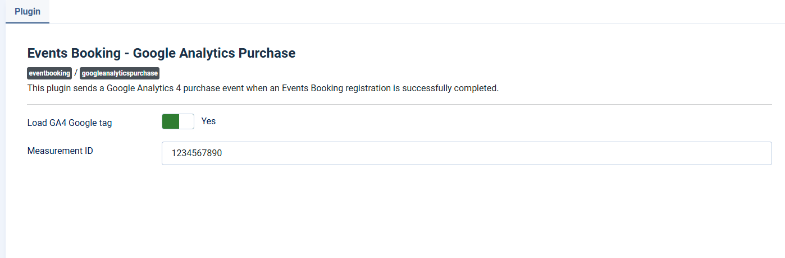

This plugin sends a [Google Analytics 4 purchase event](https://developers.google.com/analytics/devguides/collection/ga4/set-up-ecommerce) when a registration is successfully completed. The event will only be sent for paid registration. 

1. Go to **System** -> **Plugins**, find the plugin **Events Booking - Google Analytics Purchase**, click on it to edit and setup the following parameters:
- **Measurement ID**: Enter your GA4 Measurement ID (e.g., G-XXXXXXXXXX) to track purchase events.
- **Load GA4 Google tag**: If you have already loaded the GA4 Google tag on your website (usually in your site template), you can choose 'No' to prevent loading it again. Otherwise, select 'Yes' to load the GA4 Google tag.
2. Enable the plugin

