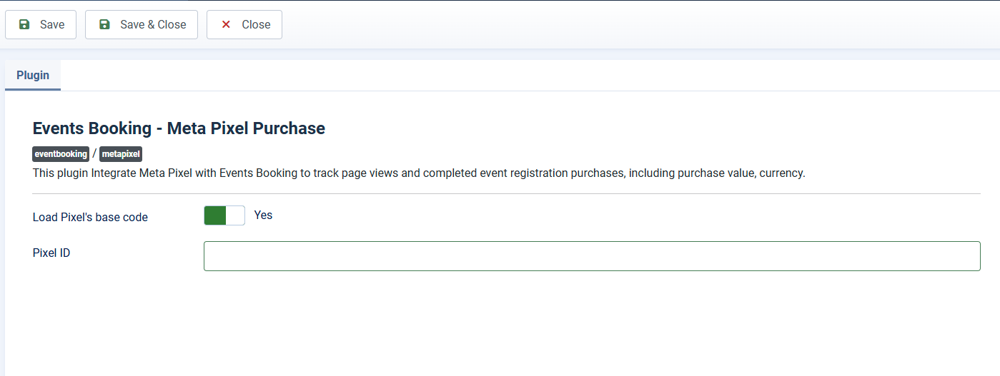

This plugin integrates Meta Pixel with Events Booking to track page views and completed event registration purchases, including purchase value, currency. The event will only be sent for paid registration. 

1. Go to **System** -> **Plugins**, find the plugin **Events Booking - Meta Pixel Purchase**, click on it to edit and setup the following parameters:
- **Pixel ID**: Enter your Pixel ID to track purchase event.
- **Load Pixel's base code**: If you have already loaded the Pixel's base code on your website, you can choose 'No' to prevent loading it again. Otherwise, select 'Yes' to load the Pixel's base code..
2. Enable the plugin

