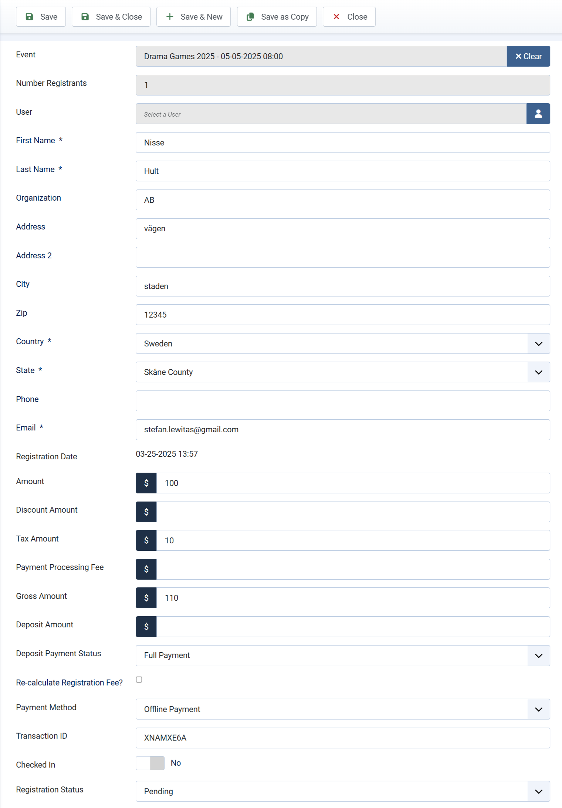

## Add New Registration
Sometime, you will need to add registration record manually (for example, when users call you to register for the event..). To do that, from registrants management screen, select the event you want to add registrant from events filter dropdown, press **New** button in the toolbar to add new registration record. A form will be displayed to allow you enter information for the registration record.

1. When add new registration record, you can choose an existing user and the system will try to fill-in the form fields auto-manatically from the data stored in his profile
2. If you fill-in a number greater than 1 (mean you are adding a group registration records) into **number registrants** field, you can only add information of group members after saving the registration record.
3. You can leave the amount inputs (Total Amount, Discount Amount, Tax Amount, Amount) empty and the system will calculate it automatically.

## Edit existing registration record
Sometime, you also need to edit a registration record to update it's information. To do that, from registrants management screen, click on the record to edit (or check on the checkbox next to the record, then press Edit button in the toolbar0. A form will be displayed to allow you update the selected registration record data. Some notes:
1. If the record you are editing is a group registration record, you can click on **Remove** button next to each group member to remove that member from group
2. If you update information of the record which change the registration fee (For example, change value of a custom fee field, remove group members), please check on **Recalcualte Registration Fee** checkbox before pressing save so that the registration fee will be updated with new information

