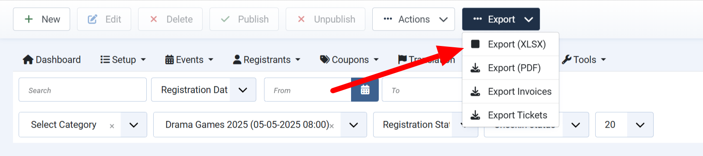
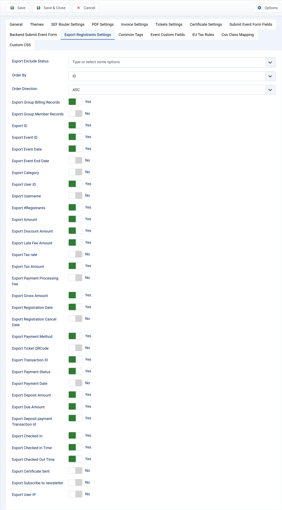
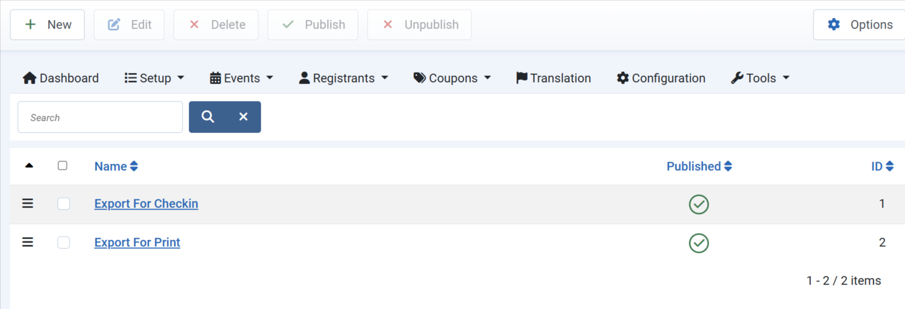
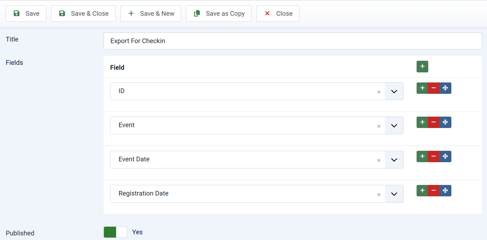
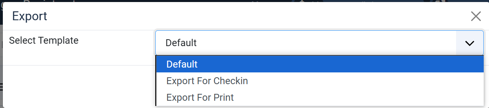

Events Booking allow you to export registrants of one or all events to Excel (XLSX) file. On Registrants Management screen, you can press **Actions -> Export (XLSX)** button in the toolbar to export registrants from one selected event or from all events. Note that, before pressing Export button, you can filter registrants data you want and only registrants meet the filter will be exported:

- If you only want to export registrants from one event, select that event from Events filter dropdown.
- If you only want to export registrants with certain Status (Pending/Paid/Cancelled), you can choose that status from Status filter dropdown.
- If you only want to export registrants with checked in status (Checked-in, not Checked-in), you can choose that checked-in status from Checked in filter dropdown.
- You can also choose date range, enter keyword in the search box to search for registrants you want before export

## Choose Type Of Records To Export
If you enable group registration in your system, there are two config options which you should care about (go to **Events Booking** -> **Configuration**, look at **Export Registrants Settings** tab, find and change it if needed):

1. If you want to include group billing records in the exported Excel file, set **Export Group Billing Records** config option to **Yes**, otherwise, set it to **No**.
2. If you want to include group members records in the exported Excel file, set **Export Group Member Records** config option to **Yes**, otherwise, set it to **No**.

## Choose Data/Columns For The Export

1. For custom fields, if you want to hide any fields in the Registrants Export, access to **Events Booking**, then **Setup** -> **Custom Fields**, click on that custom field to edit, set **Hide On Export** parameter to **Yes**.

2. For other fields, You can also choose to include/exclude fields you want. Go to **Events Booking -> Configuration**, look at  **Export Registrants Settings** tab, and change settings to meet your need.

## Export Templates
If it is needed, you can setup different export templates, each export template contains the fields in the order you want. Then when you export Registrants to Excel, you can choose to use Default Template (use the settings above) or any custom export template to have the result you want.

### Setup Export Templates

In administrator area, access to Events Booking, then **Setup** -> **Export Templates** to manage export templates and setup any number of export template you want. For each export template, you can define the fields/data you want to include and the order of these fields.

### Choose Export Template To Export Registrants
If you setup export templates, when you export registrants, you will be asked to choose the template you want and registrants will be exported using the selected template. You can choose to use Default export template beside the additional templates you added.

