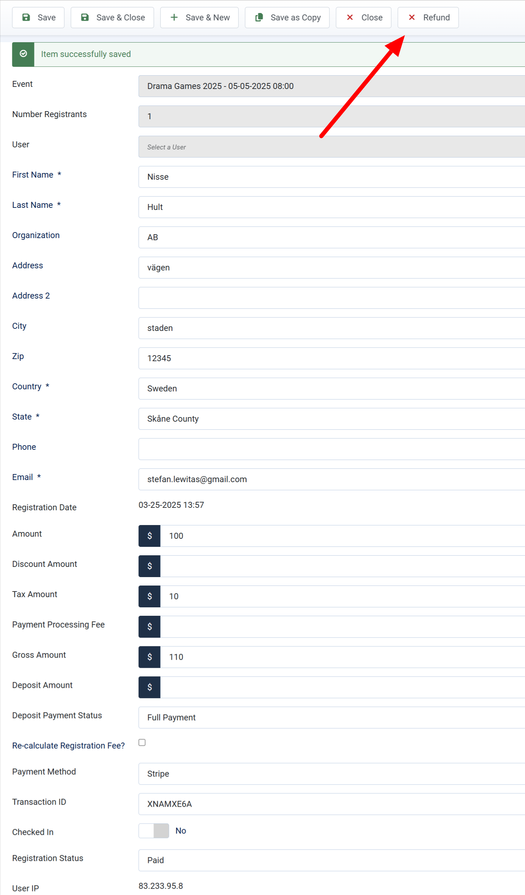

Events Booking allows admin to refund for a registration from administrator area of your site. The following payment plugin supports refund:

- PayPal
- PayPal Pro
- Stripe
- Stripe Checkout
- Square Card
- Mollie

If you use these payment plugins and registrant use one of the payment plugin for processing payment, you can follow instructions below to process refund:

- Go to Events Booking -> Registrants
- Click on the registration record you want to refund 
- Click on the Refund button in the toolbar to process refund

