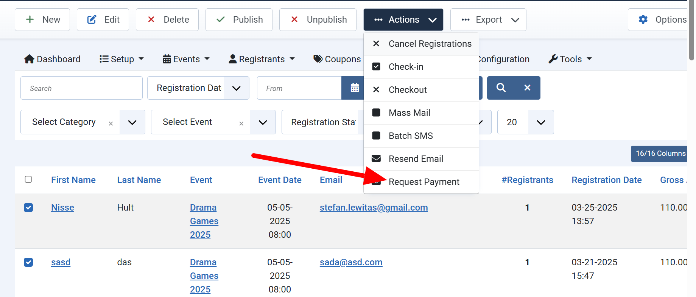

Sometime, you would want to send and email to your registrants (who has not processed payment for the registration yet) to ask them to make payment for registration. This usually happens when:

- Registrants choose Offline payment method for the registration, but now, they want to use online payment methods (such as PayPal, Stripe...) to make payment instead of sending payment manually to you.
- Or someone registers for the event, but the payment was failed for some reasons. Instead of asking them to re-register for the event, you can just send request payment email to them so that they can click on the link in the email to complete payment for the registration

If you need to use this feature:

- Go to **Events Booking -> Registrants***, check on the checkbox next to the registration record which you want to send request payment email
- And press **Action -> Request Payment** button in the toolbar.

When you do that, the registrant will receive an email contains link to process payment for that registration, They can click on the link, enter necessary information to process payment for registration and become active registrant of your event.

You should go to **Events Booking -> Emails & Messages**, find and change the subject and body of the email will be sent when you use this **Request Payment** feature:

- **Payment Request Email Subject For Pending Registration**: Subject of the email will be sent in case the current registration is Pending (for example, registrants who use offline payment or failed payment)
- **Request Payment Email Body For Pending Registration**: Body of the email which will be sent in case the current registration is Pending

- **Payment Request Email Subject**: Subject of the email will be sent in case the current registration is not Pending (for example, the registrant is in waiting list and you want them to make payment to become real registrant)
- **Request Payment Email Body**: Body of the email which will be sent in case the registrant is not Pending.

In case the registrant uses deposit payment and haven't completed the remaining payment yet, the system will send [Remaining Payment Reminder Email](/email-tags/deposit-payment-reminder-email) instead.

>>> You will have to set **Activate Waiting List Feature**  config option to **Yes** or have Pending Registration Records in the system to see this **Request Payment** button.

