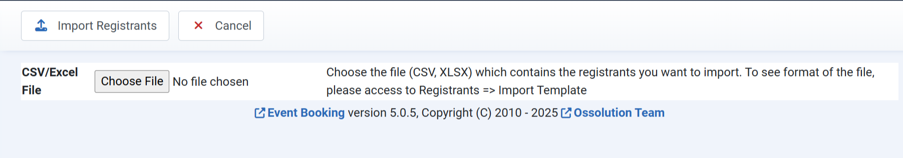

Events Booking allows you to import registrants from an Excel / CSV file. This can be used for two purposes:

1. **Update existing registration data**: You can export your current registrants data into CSV/Excel file, make the change in the exported file, then import it back into the system to hae the modified data updated
2. **Import registrants data** which is collected from outside of Events Booking into the system (for example, you might want to migrate data from other systems into Events Booking)

## Prepare Registrants Data
To import registants data into Events Booking, you need to prepare registrants data in the format which Events Booking can understand. To do that, you can login to administrator area of your site, access to Events Booking extension, then **Registrants -> Import Template** (https://domain.com/administrator/index.php?option=com_eventbooking&task=registrant.import_template - https://domain.com needs to be replaced with your site URL)

When you do that, the system will give you an **Import Template** base on the setup on your site (see a sample here [sample_import_template.xlsx](sample_import_template.xlsx)). Prepare data in that format (maybe test it with few sample records first) and you can go to next step to import this data into the system. Some notes:

1. The data **id** column must contain ID of an existing registration record if you want to update data for existing record or leave it empty. During the import, if the system founds an existing record match that ID, the data of that existing registration will be updated, otherwise, new registration record will be inserted. If you want to import new registrants data into the system, better remove that whole column
2. The **event_id** column must contain ID of the event, not title of the event.
3. The **register_date** column must contains the date which the registrant registered. It should have the format base on Date Format config option which you configured in Events Booking -> Configuration
4. The **payment_method** columns must contain name of payment method such as os_paypal, os_offline, os_authnet, not payment method title
5. The **published** column must contains number, not text. 0 => Pending, 1 => Paid, 2 => Cancelled, 3 => Waiting List

## Import Registrants

After prepare registrants data in the step earlier, you can now import these registrants into the system. From any page in Events Booking extension, access to **Registrants** -> **Import**. A form will be displayed to allow you to choose the file contains registrants data, then press **Import Registrants** button in the toolbar to process the import. Once the import completed, the system will show you number imported registrants, do a quick check and make sure the data is imported properly

