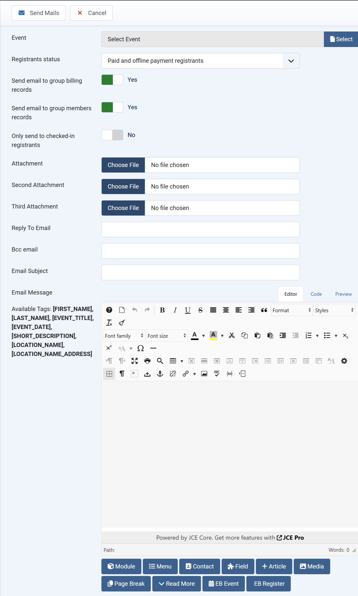

Sometime, you will want to send email to all registrants of an event. To do that, you can use Mass Mail feature. Access to **Components -> Events Booking -> Mass Mail**. A form will be displayed with the following parameters:

1. **Event**: Select the event you want to send mass mail to registrants.
2. **Registrant Status**: Choose a status here and only registrants have that status will receive email
3. **Send email to group billing records**: Choose whether you want to send email to group billing records or not (only matter if you use group registration)
4. **Send email to group members records**: Choose whether you want to send email to group member records or not (only matter if you use group registration)
5. **Only send to checked-in registrants**: If you activate Checkin Registrants feature, you will see this parameter to allow choosing if you only want to send email to checked-in registrants only
6. **Attachment**, **Second Attachment**, **Third Attachment**: Allows you to attach up to attachments to the email.
7. **Reply To Email**: Allow you to configure Reply-To email 
8. **Bcc Email**: Allows you to enter email which will receive a copy of every email sent to registrants here.
9. **Email Subject**: Enter subject of the email
10. **Email Message**: Enter body of the email

After enter necessary data in the form, you can press **Send Mails** button in the toolbar to send emails to registrants of the event which matches the filers.

