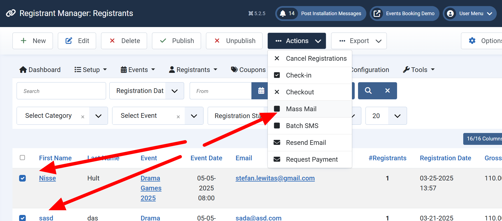
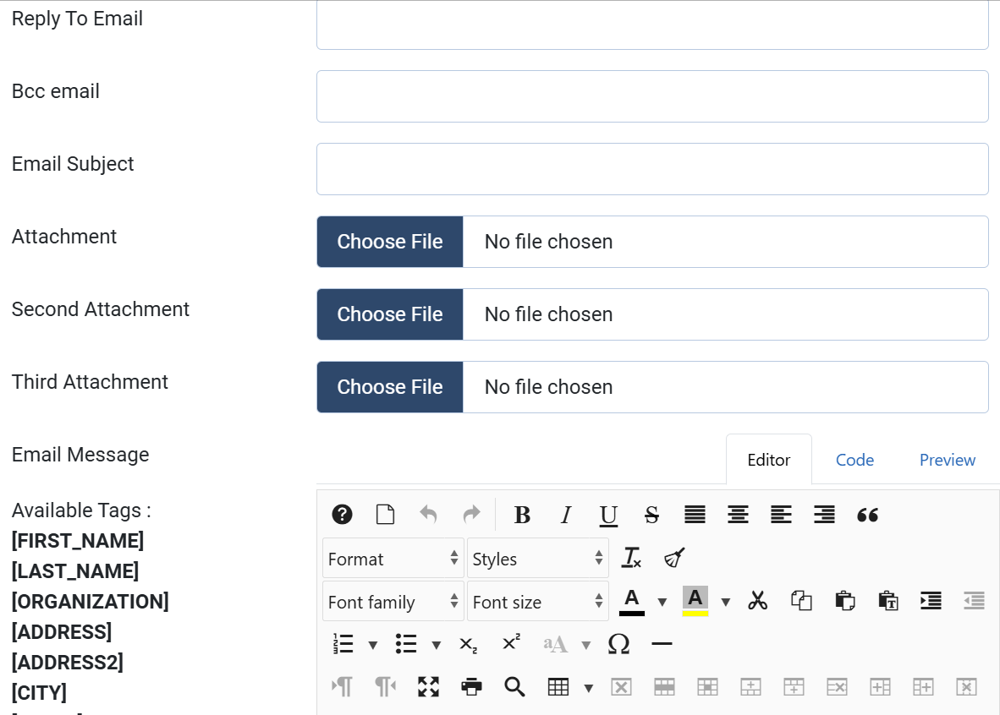

Events Booking allows you to compose email and send it to the selected registrants you want. To do that, on Registrants Management screen:

1. Check on the checkbox next to registrants you want to send email.
2. Click on Mass Mail button in the toolbar. A popup window will be displayed to allow you to compose email
3. Enter Email Subject, Email Message, upload attachments and other (optional information) in the form.
4. You can use the following tags in the email message: **[EVENT_TITLE]**, **[EVENT_DATE]**, **[EVENT_END_DATE]**, **[SHORT_DESCRIPTION]**, **[DESCRIPTION]**, **[FIRST_NAME]**, **[LAST_NAME]**, **[REGISTRATION_DETAIL]**, **[DOWNLOAD_CERTIFICATE_LINK]**
5. Press Process button at the bottom to send email

**Mass Mail button**

**Mass Mail form**
