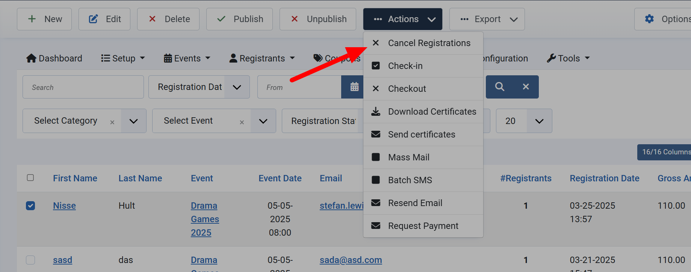

Sometime, you will need to cancel some of registrations for your event. To do that, there are two ways:

- Edit the registration record, change **Registration Status** to **Cancelled**
- Or from Registrants Management screen, check on the checkbox next to the registration records, and press **Actions -> Cancel Registrations** button in the toolbar.

## What happens when you cancel a registration
1. An email will be sent to registrants to inform them that their registration is cancelled. The email is described on this page [Admin Cancel Registration Email](/email-tags/admin-cancel-registration-email)
2. If the event is not full and there are waiting list users, the system will send an email to users in waiting lists to tell them that they can join the event. The emails are described here [Notify Waiting List Email](https://eventbookingdoc.joomservices.com/email-tags/notify-waiting-list) (you can disable the email by empty the subject of the email)
3. If you enable [Move Registrants](/plugins/move-registrants) plugin, that plugin will auto move the users from waiting lists and make them become registrants.